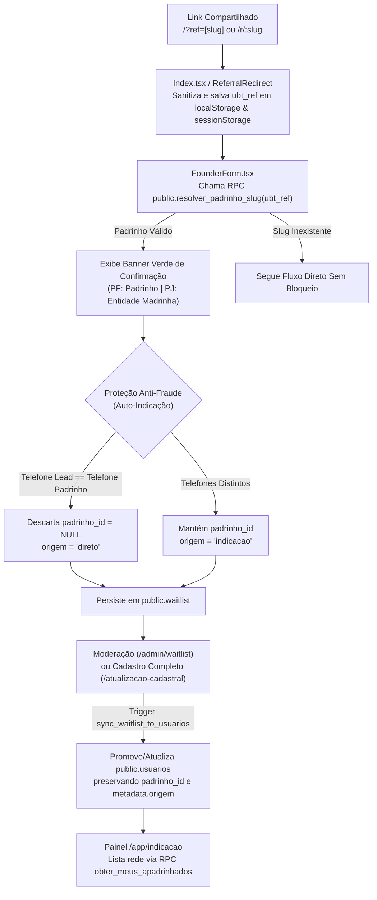

# Especificação Técnica Consolidada: Ecossistema de Apadrinhamento, Rastreabilidade e Governança Administrativa (Fases 1 e 2)

> **Ambientes Oficiais:**
> - **Produção:** [ubtservicos.vercel.app](https://ubtservicos.vercel.app) | Supabase Project: `bfqidoduceusbqlnrsol`
> - **Homologação:** [ubt-homologacao.vercel.app](https://ubt-homologacao.vercel.app) | Supabase Project: `xqujubbqcfqxkfczbidq`
>
> **Status:** HOMOLOGADO E CONGELADO EM PRODUÇÃO (CODE FREEZE)  
> **Tag de Release:** `v1.2.0-apadrinhamento-freeze` (Commit `885be9d` na branch `prod`)  
> **Documento Complementar:** [`especificacao_cadastro_fundador_enxuto.md`](./especificacao_cadastro_fundador_enxuto.md)  
> **Data de Consolidação:** 18 de Novembro de 2026  

---

## 1. Visão Geral e Regras de Negócio

### 1.1 Objetivo do Ciclo (Fases 1 e 2)
Construir a infraestrutura ponta a ponta de **captura, resolução segura, persistência relacional, auditoria administrativa e visibilidade para o usuário** do programa **Padrinho / Madrinha UBT**, cobrindo indicações bilaterais de **Pessoa Física (PF)** e **Pessoa Jurídica / Entidades (PJ / Associações)**.

Este ciclo garante que todo membro captado via link de indicação (`/?ref=[slug]` ou `/r/:slug`) carregue de forma íntegra o vínculo com o seu padrinho/madrinha (`padrinho_id`) desde a entrada na `public.waitlist` até a consolidação do usuário ativo em `public.usuarios`, deixando o banco de dados pronto para o acionamento do repasse financeiro na **Fase 3 (Split Financeiro)**.

### 1.2 Fluxo de Indicação Bilateral e Rastreabilidade de Origem



### 1.3 Regras de Negócio Estabelecidas

1. **Indicação Bilateral (PF ↔ PJ):**
   - Tanto usuários Pessoa Física (`role: 'tomador'` / `'prestador'`) quanto Entidades Jurídicas (`role: 'associacao'`) podem atuar como padrinhos/madrinhas e gerar links exclusivos com Vanity Slug.
   - Da mesma forma, tanto leads PF quanto leads PJ podem ser apadrinhados ao ingressarem por meio de um link com `?ref=`.
2. **Rastreabilidade Estrita de Origem (`origem`):**
   - Todo cadastro gravado em `public.usuarios.metadata.origem` recebe o marcador explícito:
     - `'indicacao'` quando vinculado a um `padrinho_id` válido.
     - `'direto'` quando ingressa sem indicação ou após bloqueio anti-fraude.
   - O campo relacional `padrinho_id` em `public.waitlist` e `public.usuarios` nunca é sobrescrito acidentalmente por atualizações posteriores se já houver um padrinho consolidado (`COALESCE(public.usuarios.padrinho_id, NEW.padrinho_id)`).
3. **Proteção Anti-Fraude Contra Auto-Indicação:**
   - Durante a submissão em `FounderForm.tsx`, o telefone informado pelo novo lead é normalizado (apenas dígitos) e comparado com `padrinho_telefone` retornado pela RPC `resolver_padrinho_slug`.
   - Caso haja coincidência numérica (`cleanLeadPhone === cleanPadrinhoPhone`), o front-end anula automaticamente `padrinho_id` para `null` e registra `origem: 'direto'`, impedindo que o usuário utilize o próprio link para autopromoção no futuro split financeiro.

---

## 2. Arquitetura de Banco de Dados (Homologação & Produção)

Todas as alterações de banco foram aplicadas de forma idempotente via migrações versionadas em `supabase/migrations/` nos projetos **Homologação (`xqujubbqcfqxkfczbidq`)** e **Produção (`bfqidoduceusbqlnrsol`)**, sem contaminação por dados fictícios em Produção.

### 2.1 Inventário de Migrações Aplicadas no Ciclo

| Arquivo de Migração | Responsabilidade Principal |
| :--- | :--- |
| `20261110171500_add_padrinho_waitlist_and_resolver_rpc.sql` | Adiciona `padrinho_id`, `referral_slug` e `idx_waitlist_padrinho_id` em `public.waitlist`; cria RPC `resolver_padrinho_slug(text)`; atualiza trigger `sync_waitlist_to_usuarios`. |
| `20261110174000_create_obter_meus_apadrinhados_rpc.sql` | Garante coluna `created_at` em `public.waitlist` e cria RPC `obter_meus_apadrinhados(uuid)`. |
| `20261111150000_fix_sync_waitlist_to_usuarios_role_mapping.sql` | Corrige erro `23514` (`usuarios_role_check`) mapeando papéis de entrada (`morador`, `turista`) para `tomador` na trigger `sync_waitlist_to_usuarios`. |
| `20261112123000_alter_system_logs_user_id_fkey_to_auth_users.sql` | Recria `system_logs_user_id_fkey` apontando para `auth.users(id) ON DELETE SET NULL`, permitindo telemetria com `user_id = NULL`. |
| `20261112183000_equalize_prod_schema_columns.sql` | Equaliza colunas entre ambientes: `associacao_id` em `associacao_membros`, `slug` em `waitlist`, e `razao_social`, `nome_fantasia`, `num_associados` em `usuarios`. |
| `20261117185000_fix_admin_rls_and_sync_waitlist.sql` | Equaliza `is_admin()` / `check_is_admin()` (`SECURITY DEFINER`), adiciona políticas RLS `admin_manage_usuarios` e `admin_manage_waitlist`, atualiza `usuarios_role_check` e torna `sync_waitlist_to_usuarios` resiliente a conflitos por ID, telefone ou e-mail. |

### 2.2 Alterações DDL em `public.waitlist`, `public.usuarios` e `public.associacao_membros`

- **`public.waitlist`:**
  - `padrinho_id uuid REFERENCES public.usuarios(id) ON DELETE SET NULL`
  - `idx_waitlist_padrinho_id` (índice B-Tree sobre `waitlist(padrinho_id)`)
  - `referral_slug text` e `slug text` (sincronizados com `COALESCE(referral_slug, referral_code)`)
  - `created_at timestamptz DEFAULT now()` (sincronizado com `created_at_utc` para registros legados)
- **`public.usuarios`:**
  - `padrinho_id uuid REFERENCES public.usuarios(id) ON DELETE SET NULL`
  - Colunas corporativas equalizadas para entidades PJ: `razao_social text`, `nome_fantasia text`, `num_associados text`
  - Check constraint `usuarios_role_check` equalizada aceitando: `('tomador', 'prestador', 'admin', 'superadmin', 'super_admin', 'cocoecia', 'associacao', 'user')`
- **`public.associacao_membros`:**
  - Coluna `associacao_id uuid` garantida e sincronizada com a coluna legada `association_id` presente em Produção.

### 2.3 Funções `SECURITY DEFINER` (Anti-Exposição PII)

#### A. `public.resolver_padrinho_slug(p_slug text)`
- **Finalidade:** Converter um código/slug textual em dados mínimos de vinculação sem liberar acesso irrestrito à tabela `public.usuarios` para visitantes anônimos.
- **Lógica de Busca:** Normaliza `lower(trim(p_slug))` e realiza `LEFT JOIN` entre `public.usuarios` e `public.waitlist` comparando em ordem case-insensitive contra:
  - `w.referral_slug`
  - `w.referral_code`
  - `u.referral_code`
  - `u.metadata->>'referral_slug'`
  - `u.metadata->>'referral_code'`
- **Retorno:** `TABLE (padrinho_id uuid, nome_exibicao text, tipo_padrinho text, padrinho_telefone text)` (`LIMIT 1`).
- **Permissões:** `GRANT EXECUTE ... TO anon, authenticated`.

#### B. `public.obter_meus_apadrinhados(p_padrinho_id uuid)`
- **Finalidade:** Alimentar a tela `/app/indicacao` e as abas de rede administrativa com a relação de indicados de um padrinho específico, sem expor telefones, CPFs ou e-mails na camada pública.
- **Retorno:** `TABLE (id uuid, nome text, tipo_cadastro text, status text, cadastro_completo boolean, criado_em timestamptz)` ordenados de forma decrescente por `COALESCE(w.created_at, w.created_at_utc, now())`.
- **Permissões:** `GRANT EXECUTE ... TO anon, authenticated`.

### 2.4 Trigger `public.sync_waitlist_to_usuarios()`

Executada em `AFTER INSERT OR UPDATE ON public.waitlist` com `SECURITY DEFINER`:

1. **Auto-Confirmação de E-mail:** Atualiza `auth.users.email_confirmed_at = COALESCE(email_confirmed_at, now())` para evitar falhas de login por e-mail pendente de confirmação.
2. **Vínculo de `user_id`:** Se `NEW.user_id` estiver nulo, tenta localizar o ID correspondente em `auth.users` pelo e-mail (respeitando a FK `waitlist_user_id_fkey`).
3. **Mapeamento Seguro de Papéis (Resolução do Erro `23514`):**
   - Se `tipo_cadastro IN ('pj', 'associacao', 'PJ')` ou `cnpj IS NOT NULL` ou `razao_social IS NOT NULL` $\rightarrow$ `v_role := 'associacao'`.
   - Se `NEW.role IN ('prestador', 'trabalhador')` $\rightarrow$ `v_role := 'prestador'`.
   - Se `NEW.role IN ('admin', 'superadmin', 'super_admin')` $\rightarrow$ `v_role := 'admin'`.
   - Demais papéis de entrada (como `'morador'`, `'turista'`) $\rightarrow$ `v_role := 'tomador'`.
4. **Resolução Multi-Chave de Duplicidades:**
   - Disparada quando `NEW.cadastro_completo = true` ou `NEW.status IN ('aprovado', 'approved', 'completo')`.
   - Localiza registro pré-existente em `public.usuarios` em cascata por `id = NEW.user_id`, `telefone = NEW.telefone` ou `LOWER(email) = LOWER(NEW.email)`.
   - Quando encontrado, executa `UPDATE` preservando papéis administrativos (`admin`, `superadmin`, `super_admin`) e mantendo `padrinho_id` já consolidado (`COALESCE(public.usuarios.padrinho_id, NEW.padrinho_id)`).
   - Quando inexistente, executa `INSERT` gravando `padrinho_id` e enriquecendo `metadata` com `origem`, `tipo_cadastro`, `role_waitlist`, `status_waitlist` e `cadastro_completo`.

### 2.5 Segurança, RLS e Integridade de Telemetria (`system_logs`)

1. **Resolução do Bloqueio RLS em `/admin/clientes`:**
   - **Diagnóstico:** Em Produção, a função `check_is_admin()` consultava `public.profiles` (onde o Super Admin `ubt.servicos@gmail.com` não possuía linha) e `is_admin()` comparava `role IN (..., 'super_admin')` (com underscore), enquanto a conta em `public.usuarios` possuía `role = 'superadmin'` (sem underscore). Consequentemente, todas as linhas de clientes (`role = 'tomador'`) eram ocultadas pelo RLS, retornando apenas a linha do próprio administrador.
   - **Solução (`20261117185000_fix_admin_rls_and_sync_waitlist.sql`):**
     - `public.is_admin()` e `public.check_is_admin()` reescritas com `SECURITY DEFINER SET search_path = public` (prevenindo erro de recursão `42P17`), verificando o e-mail administrativo no JWT (`ubt.servicos@gmail.com`, `admin@ubt.app`), os papéis `('admin', 'superadmin', 'super_admin', 'operator', 'financeiro', 'moderador')` em `public.usuarios` e fallback em `auth.users` / `public.profiles`.
     - Políticas explícitas `admin_manage_usuarios` (em `public.usuarios`) e `admin_manage_waitlist` (em `public.waitlist`) criadas com `FOR ALL TO authenticated USING (public.is_admin()) WITH CHECK (public.is_admin())`.
2. **Correção de Logs Anônimos (`409 Conflict` em `system_logs`):**
   - Alterada `system_logs_user_id_fkey` para referenciar `auth.users(id) ON DELETE SET NULL`, permitindo que eventos disparados antes da autenticação (como na tela `/login`) persistam normalmente com `user_id = null`.

---

## 3. Camada de Front-End e Experiência do Usuário

### 3.1 Captura Resiliente na Entrada (`src/pages/Index.tsx` & `src/App.tsx`)
- **`src/pages/Index.tsx`:** No carregamento inicial (`useEffect`), lê `?ref=` de `window.location.search`, remove barras, contrabarras e espaços residuais (`rawRef.trim().replace(/[\\/\s]/g, "")`) e armazena de forma redundante em:
  - `localStorage.setItem("ubt_ref", cleanRef)`
  - `sessionStorage.setItem("ubt_ref", cleanRef)`
- **`src/App.tsx` (`ReferralRedirect`):** A rota curta `/r/:slug` salva o `slug` tanto em `sessionStorage` quanto em `localStorage` sob a chave `ubt_ref` e redireciona imediatamente para `/?ref=${encodeURIComponent(slug)}#cadastro-fundadores-cap`.

### 3.2 Resolução, Banner e Bloqueio Anti-Fraude (`src/components/FounderForm.tsx`)
- No mount do formulário, recupera o slug (priorizando a URL `?ref=` e usando `localStorage`/`sessionStorage` como fallback) e executa `supabase.rpc("resolver_padrinho_slug", { p_slug: cleanSlug })`.
- Quando resolvido com sucesso, exibe **banner esmeralda de confirmação** acima do formulário:
  - Para Padrinho PF: `"Convidado por [Nome]"` — *"Membro Fundador Padrinho UBT"*.
  - Para Entidade PJ: `"Convidado por [Nome]"` — *"Entidade Madrinha: [Nome]"*.
- Na submissão (`onSubmit`), valida se `cleanLeadPhone === cleanPadrinhoPhone`:
  - Em caso de tentativa de auto-indicação, anula `finalPadrinhoId = null` e envia `origem: "direto"`.
  - Caso contrário, envia `padrinho_id: finalPadrinhoId` e `origem: "indicacao"` no payload de `public.waitlist`.
- No modal de boas-vindas pós-cadastro, exibe o feedback visual: *"Apadrinhado com sucesso por: [Nome do Padrinho]"*.

### 3.3 Feedback na Esteira de Atualização (`src/pages/AtualizacaoCadastral.tsx`)
- Ao carregar os dados do lead na esteira `/atualizacao-cadastral`, se `waitlist.padrinho_id` estiver preenchido, resolve e exibe um banner informativo no topo do wizard confirmando o vínculo de apadrinhamento com o nome do padrinho ou entidade madrinha.

### 3.4 Painel do Usuário — "Sua Rede de Apadrinhados" (`src/pages/IndicacaoPage.tsx`)
- A página `/app/indicacao` resolve o usuário ativo (por parâmetro `tel`, `supabase.auth.getUser()`, `getSession()` ou `onAuthStateChange`) e invoca `supabase.rpc("obter_meus_apadrinhados", { p_padrinho_id })`.
- Renderiza o card **Sua Rede de Apadrinhados** com:
  - **KPIs Resumidos:** Total de Indicados, Cadastros Completos/Ativos e Pendentes na Esteira.
  - **Lista Detalhada:** Nome de exibição, tag diferenciada `PF` ou `PJ`, status de completude cadastral e data de ingresso formatada, além de estado vazio amigável incentivando o primeiro compartilhamento do link/QR Code.

### 3.5 Auditoria Administrativa e Resiliência (`/admin/*`)

| Tela Administrativa | Arquivo | Recursos de Auditoria e Resiliência Implementados |
| :--- | :--- | :--- |
| **Waitlist** | `src/pages/admin/AdminWaitlistPage.tsx` | Enriquecimento dos leads resolvendo `padrinho_id` em `public.usuarios`; coluna de origem com badge esmeralda (`[Nome Padrinho] · PF/PJ`) ou badge neutra (`Direto (Sem Padrinho)`); card de origem no modal de detalhes. |
| **Clientes (PF)** | `src/pages/admin/AdminClientesPage.tsx`<br/>`src/pages/admin/AdminClienteDetailPage.tsx` | Queries auxiliares isoladas via `Promise.allSettled` (garantindo que nenhuma falha secundária bloqueie a listagem principal); suporte bidirecional a `associacao_id` e `association_id`; coluna de origem (`Padrinho` vs `Direto`); seção dedicada de **Apadrinhados** na página de detalhes do cliente via `obter_meus_apadrinhados`. |
| **Entidades (PJ)** | `src/pages/admin/AdminEntidadesPage.tsx` | Importação corrigida dos ícones `Users`, `User`, `Handshake`; exibição da origem/padrinho da entidade e listagem da rede de apadrinhados da associação no modal de detalhes via `obter_meus_apadrinhados`. |

### 3.6 Higienização de Telemetria (`AnalyticsService.ts` & `LoggingService.ts`)
- Criada e aplicada a função utilitária `isValidUuid` antes de persistir eventos em `analytics_events` e `system_logs`. Valores não-UUID, vazios ou inválidos são convertidos em `null`, evitando erros `409 Conflict` por violação de chave estrangeira durante sessões anônimas.

---

## 4. Qualidade e Testes Automatizados

A bateria de validação da versão congelada (`v1.2.0-apadrinhamento-freeze`) foi executada na íntegra antes do release freeze:

```text
================================================================================
RELATÓRIO DE VALIDAÇÃO DA BASELINE CONGELADA (v1.2.0-apadrinhamento-freeze)
================================================================================
Type-check (TypeScript):    npx tsc --noEmit     -> 0 erros (PASS)
Suíte de Testes (Vitest):   npm test -- --run    -> 20/20 arquivos, 236/236 testes PASS
Build de Produção (Vite):   npm run build        -> Sucesso em 28.61s (dist/ gerado)
Commit em Produção (prod):  885be9d              -> Sincronizado com origin/prod
Tag de Congelamento:        v1.2.0-apadrinhamento-freeze -> Publicada em origin
================================================================================
```

### Cobertura Específica de Apadrinhamento (`src/test/referral/referralResolution.test.ts`)
Os 7 cenários unitários implementados validam:
1. Resolução bem-sucedida de slug válido retornando `padrinho_id`, `nome_exibicao` e `tipo_padrinho`.
2. Sanitização de slugs com barras e espaços residuais (ex.: `" /associacao-ubt/ \n"` $\rightarrow$ `"associacao-ubt"`).
3. Tratamento gracioso de slug inexistente retornando `null` sem exceções.
4. Tratamento gracioso de erro de rede/RPC retornando `null`.
5. Bloqueio de auto-indicação quando o telefone do lead coincide com o telefone do padrinho (`padrinho_id: null`, `origem: "direto"`, `isAutoIndicacao: true`).
6. Persistência de `origem: "indicacao"` e `padrinho_id` válido quando telefones são distintos.
7. Persistência de `origem: "direto"` e `padrinho_id: null` na ausência de padrinho.

---

## 5. Baseline Congelada e Próximo Passo (Fase 3 — Split Financeiro)

### 5.1 Política de Code Freeze
- A tag anotada **`v1.2.0-apadrinhamento-freeze`** marca a linha de base imutável das Fases 1 e 2 em Produção (`885be9d`).
- **Bloqueio de Alterações:** Nenhuma modificação nos diretórios `src/` ou `supabase/` deve ser promovida para a branch `prod` até a abertura formal da **Fase 3 (Split Financeiro)**.

### 5.2 Arquitetura Preparada para a Fase 3
O modelo de dados de split (`supabase/migrations/20260904_split_padrinho_split.sql`) já dispõe das colunas necessárias em `public.split_config` e `public.pagamentos_split`:
- **`public.split_config`:**
  - `padrinho_tomador_pct`: `0.500` (0,5% destinado ao padrinho do tomador)
  - `padrinho_prestador_pct`: `0.500` (0,5% destinado ao padrinho do prestador)
- **`public.pagamentos_split`:**
  - `godparent_tomador_id uuid` / `godparent_tomador_amount numeric`
  - `godparent_prestador_id uuid` / `godparent_prestador_amount numeric`

Na **Fase 3**, o motor financeiro e o webhook de liquidação consultarão `public.usuarios.padrinho_id` tanto para o `tomador_id` quanto para o `prestador_id` envolvidos na transação, populando automaticamente `godparent_tomador_id` e `godparent_prestador_id` em `pagamentos_split` e efetuando o crédito/redirecionamento do respectivo repasse quando o padrinho existir e estiver ativo (ou revertendo a cota conforme regra de negócio quando `padrinho_id IS NULL`).


---

## 6. Fase 3 — Split Financeiro de Apadrinhamento, Contingenciamento por Chave PIX e Mercado Pago (Produção)

> **Status:** HOMOLOGADO E PROMOVIDO PARA PRODUÇÃO  
> **Tag de Release:** `v1.3.0-split-apadrinhamento-prod`  
> **Migração Aplicada (Homologação & Produção):** `supabase/migrations/20261119120000_fase3_split_apadrinhamento_contingenciamento.sql`  
> **Edge Function Implantada (Homologação & Produção):** `supabase/functions/payment-gateway/index.ts`  
> **Data de Promoção:** 19 de Novembro de 2026  

### 6.1 Regras de Alocação e Contingenciamento no Split
- **Sem Padrinho (`padrinho_id IS NULL`):** A cota de 0,5% segue a regra padrão destinada ao fundo de reserva da plataforma, com `status_repasse_* = 'nao_aplicavel'`.
- **Com Padrinho e COM Chave PIX cadastrada:** Preenche `godparent_tomador_id` / `godparent_prestador_id`, aloca os 0,5% correspondentes e define `status_repasse_* = 'pendente_repasse'` (pronto para liquidação).
- **Com Padrinho e SEM Chave PIX cadastrada:** Preenche `godparent_tomador_id` / `godparent_prestador_id`, retém os 0,5% integralmente para o padrinho (sem redirecionar ao fundo de reserva) e define `status_repasse_* = 'contingenciado'`.
- **Liberação Automática:** Assim que o padrinho (ou o administrador) salva uma `chave_pix` válida em `public.usuarios`, a trigger `trg_liberar_contingenciamento_pix` converte automaticamente todos os repasses `'contingenciado'` daquele padrinho para `'pendente_repasse'`.

### 6.2 Objetos de Banco de Dados da Fase 3
- **Colunas em `public.usuarios`:** `chave_pix`, `tipo_chave_pix`, `possui_mercadopago boolean NOT NULL DEFAULT false` (com backfill a partir de `waitlist`, `profiles.pix_key` e `marketplace_accounts`).
- **Colunas e Constraints em `public.pagamentos_split`:** `tomador_id`, `status_repasse_godparent_tomador`, `status_repasse_godparent_prestador`, `repasse_godparent_tomador_em`, `repasse_godparent_prestador_em`, FKs para `public.usuarios(id)`, check constraints (`'nao_aplicavel'`, `'pendente_repasse'`, `'contingenciado'`, `'pago'`) e índices `idx_pagamentos_split_godparent_tomador` / `idx_pagamentos_split_godparent_prestador`.
- **Funções e Triggers (`SECURITY DEFINER`):**
  - `public.usuario_possui_chave_pix(uuid)`
  - `public.resolve_godparent_split_contingency()` + trigger `trg_resolve_godparent_split_contingency` (`BEFORE INSERT OR UPDATE ON pagamentos_split`)
  - `public.liberar_contingenciamento_ao_salvar_pix()` + trigger `trg_liberar_contingenciamento_pix` (`AFTER INSERT OR UPDATE OF chave_pix ON usuarios`)
  - `public.obter_resumo_financeiro_apadrinhamento(p_padrinho_id uuid)`
  - `public.salvar_chave_pix_usuario(p_user_id uuid, p_chave_pix text, p_tipo_chave_pix text)`
  - `public.atualizar_status_mercadopago_usuario(p_user_id uuid, p_possui boolean)`
- **RLS:** Política `godparent_read_own_pagamentos_split` em `public.pagamentos_split` permitindo leitura autenticada aos participantes (`godparent_tomador_id`, `godparent_prestador_id`, `godparent_id`, `tomador_id`, `provider_id`) e administradores (`is_admin()`).

### 6.3 Motor de Split, UI do Usuário e Painéis Administrativos
- **Motor Puro (`src/lib/finance/splitEngine.ts`):** Funções `resolveGodparentAllocation` e `releaseContingencyRepasses` cobertas por 5 testes unitários dedicados em `src/test/split/godparentSplit.test.ts` (suíte total: **21 arquivos, 241 testes PASS**).
- **Gateway (`supabase/functions/payment-gateway/index.ts`):** Função `resolveGodparentSplitContext` resolve automaticamente os padrinhos do tomador e do prestador no servidor, verifica chave PIX e grava os status de contingenciamento em `pagamentos_split`.
- **`/app/indicacao` (`IndicacaoPage.tsx`):** Cards financeiros de **Ganhos por Apadrinhamento** (Saldo Liberado/Disponível, Saldo Contingenciado e Histórico dos Repasses) + banner de alerta/cadastro rápido `PixContingencyBanner.tsx`.
- **`/app/gerenciar` (`GerenciarPage.tsx` + `MercadoPagoOnboardingCard.tsx`):** Alert compacto no **topo** da página com identidade visual gamer/bets (`#0b0f14` / `#111827`, borda neon âmbar/esmeralda) que expande suavemente ao clicar, explicando que **a abertura da conta no Mercado Pago é fundamental para movimentar e receber na plataforma e é totalmente gratuita**, com CTA oficial (`https://www.mercadopago.com.br/hub/registration/landing`), confirmação *"Já possuo conta"* e cadastro rápido de chave PIX.
- **`/admin/clientes`, `/admin/clientes/:id` e `/admin/entidades`:** Alerta **`⚠️ Sem chave PIX`**, editor rápido inline `AdminPixQuickEditor.tsx` e filtro toggle **`⚠️ Sem chave PIX`** nas barras de filtros de Clientes e Entidades.


---

## 7. Ecossistema Côco & Cia, Slug/ID UBT Editável e Operação em Campo (Produção)

> **Status:** HOMOLOGADO E PROMOVIDO PARA PRODUÇÃO  
> **Tag de Release:** `v1.4.0-coco-cia-prod`  
> **Ambientes:** Produção ([ubtservicos.vercel.app](https://ubtservicos.vercel.app) / `bfqidoduceusbqlnrsol`) e Homologação ([ubt-homologacao.vercel.app](https://ubt-homologacao.vercel.app) / `xqujubbqcfqxkfczbidq`)  
> **Data de Promoção:** 19 de Novembro de 2026  

### 7.1 Migrações Aplicadas de Forma Idempotente (Homologação & Produção — Apenas DDL/Funções/RLS)

| Arquivo de Migração | Responsabilidade Principal |
| :--- | :--- |
| `20261119171000_fix_coco_dicas_materiais_rls.sql` | Garante colunas `is_active`/`updated_at`, função `public.can_manage_coco_manuais()` e RLS completa para CRUD em `public.coco_dicas_materiais`. |
| `20261119175500_simplify_coco_colaboradores.sql` | Torna `veiculo` e `bairro_atuacao` opcionais em `public.coco_colaboradores`, adiciona `is_ativo`/`updated_at` e policy `coco_colaboradores_manage_policy`. |
| `20261119181000_restructure_coco_frota.sql` | Adiciona `colaboradores_ids uuid[]`, `hora_saida` e `expectativa_retorno` em `public.coco_caminhoes` e policy `coco_caminhoes_manage_policy`. |
| `20261119201000_coco_colaboradores_perfil_e_requerimento.sql` | Adiciona `user_id`, `perfil`, `status_aprovacao`, `aprovado_por`, `aprovado_em` em `public.coco_colaboradores`; amplia `usuarios_role_check`; cria RPC `gerenciar_vinculo_colaborador_coco` e policies de requerimento próprio. |
| `20261119210000_coco_slug_perfil_prestador_coleta.sql` | Adiciona `ubt_slug` e perfil `'prestador'` em `public.coco_colaboradores`; adiciona `coletado_por`/`coletado_por_nome` em `public.coco_pontos`; cria `is_coco_field_collaborator()`, `resolver_usuario_por_slug_ubt(text)` e `confirmar_coleta_ponto_coco(uuid, uuid)`; atualiza RLS de `coco_pontos` e `coco_caminhoes`. |
| `20261119213000_atualizar_meu_slug_ubt.sql` | Cria RPC `SECURITY DEFINER` `public.atualizar_meu_slug_ubt(text)` com validação de formato, checagem de unicidade case-insensitive em `public.usuarios.referral_code` e sincronização automática em `public.coco_colaboradores.ubt_slug`. |

### 7.2 Geolocalização Local-First e Endereço Completo Editável
- **Tratamento Seguro da Geocoding API (`src/lib/googleMapsConfig.ts`, `src/lib/geoService.ts`, `src/hooks/useGeolocation.ts`):**
  - Introduzida flag `GOOGLE_GEOCODING_ENABLED` (default `false`) e circuit-breaker em memória contra `REQUEST_DENIED`, eliminando erros de Geocoding API no console.
  - `reverseGeocode(lat, lng)` opera em cascata local-first: **Cache local** $\rightarrow$ **`ceps_ubatuba` mais próximo** $\rightarrow$ **OpenStreetMap Nominatim** (`zoom=18&addressdetails=1&accept-language=pt-BR`, retornando logradouro, número aproximado e bairro em Ubatuba - SP) $\rightarrow$ Google Geocoder (apenas se explicitamente ativado) $\rightarrow$ fallback estruturado por bairro + coordenadas.
- **Botão Alvo (`target`) Editável em `/app/coco` (`src/pages/CocoPage.tsx`):**
  - Captura GPS de alta precisão (`enableHighAccuracy: true`), resolve o endereço completo via `reverseGeocode` e foca o campo mantendo-o 100% editável para o Tomador ajustar número exato ou ponto de referência.

### 7.3 Manuais Educativos, Colaboradores, Perfis e RBAC do Menu Côco & Cia
- **Manuais Educativos (`/admin/coco/manuais`):** CRUD completo persistido em `public.coco_dicas_materiais` (criar, editar, ativar/inativar, excluir e limpeza de duplicados) protegido por `public.can_manage_coco_manuais()`.
- **Colaboradores (`/admin/coco/colaboradores`):**
  - Formulário simplificado com **Nome Completo** e **Telefone / WhatsApp** com máscara e validação REGEX (`(XX) XXXXX-XXXX`).
  - Vínculo administrativo por **ID / Slug UBT** (`resolver_usuario_por_slug_ubt`), removendo a opção pública de auto-vinculação por placa de caminhão em `CocoOnboardingPage.tsx`.
  - Bloco de **Requerimentos Pendentes** com aprovação/rejeição via `gerenciar_vinculo_colaborador_coco`.
  - **Perfis e RBAC (`AdminLayout.tsx`, `AdminRoute.tsx`, `App.tsx`):**
    - **Superadmin UBT e Alta Gestão (`alta_gestao` / `cocoecia-dirigentes`):** visão completa das 8 rotas do menu **Côco & Cia** (Dashboard, Mapa Operacional, Agenda, Manuais, Captação, Frota, Colaboradores e Configurações).
    - **Colaborador Administrativo (`colaborador_administrativo` / `cocoecia-colaborador`):** acesso restrito exclusivamente às 5 páginas operacionais (**Mapa**, **Agenda**, **Manuais**, **Colaboradores** e **Frota**).
    - **Prestador (`prestador`):** **sem acesso** ao painel `/admin/coco/*`; mantém seu acesso normal de `tomador` no app e opera rotas/coletas exclusivamente em `/app/prestador/coco/online`.
    - Removido papel `"tomador"` das rotas administrativas `/admin/coco/*` e restringido o atalho **Côco & Cia** em `/app/prestador/home` apenas a colaboradores ativos em `public.coco_colaboradores`.

### 7.4 Reestruturação de Frota (`/admin/coco/frota`)
- Removida completamente a chave PIX do caminhão em `/admin/coco/frota`, `CocoOnlinePage.tsx` e `ConfigCocoPage.tsx`.
- Implementado componente **`DualListboxColaboradores.tsx`** (duas colunas responsivas: *Disponíveis* com busca rápida e *Vinculados ao Caminhão* com remoção rápida), persistindo `colaboradores_ids` em `public.coco_caminhoes`.
- Adicionada ordenação sequencial de **Rotas Bairro a Bairro** (`1º → 2º → ...` com controles subir/descer) e horários de **Saída** (`hora_saida`) e **Expectativa de Retorno** (`expectativa_retorno`).

### 7.5 Operação em Campo, Confirmação ao Tomador, Visual Gamer/Bets e Slug Editável
- **Operação em `/app/prestador/coco/online` (`CocoOnlinePage.tsx`):**
  - Corrigida importação de `useSimpleToast`.
  - Colaboradores vinculados via `colaboradores_ids` ou `prestador_id` visualizam a rota ordenada, horários de saída/retorno e pontos pendentes ordenados conforme a sequência de bairros, podendo clicar em **OK / Confirmar Coleta** em cada endereço (`confirmar_coleta_ponto_coco`).
- **Confirmação ao Tomador em `/app/coco` (`CocoPage.tsx`):**
  - Ao confirmar a coleta, `public.coco_pontos` é atualizado (`status = 'coletado'`, `coletado_at`, `coletado_por`, `coletado_por_nome`) e uma notificação é gravada em `public.in_app_notifications` para o `tomador_id`.
  - A aba **Acompanhar** e o listener realtime exibem banner verde neon confirmando que o pacote foi recolhido no endereço informado.
- **Identidade Visual Gamer / Bets:**
  - Aplicada em `/app/coco`, `/app/prestador/coco/online` e `/app/prestador/coco/onboarding`: fundo dark profundo (`#0B0F14` / `#111827`), bordas neon esmeralda (`rgba(16,185,129,0.35)`), badges e tabs em `uppercase` com `tracking-wider` e alto contraste.
- **ID / Slug UBT Genérico e Editável (`/app/config/perfil` — `ConfigPerfilPage.tsx`):**
  - Card institucional neutro **`SEU ID / SLUG NA PLATAFORMA UBT`** (sem menções à Côco & Cia), com botões **Copiar** e **Editar** (sanitização automática, validação de formato e unicidade via `atualizar_meu_slug_ubt`).

### 7.6 Baseline de Produção (`v1.4.0-coco-cia-prod`)
- **Type-check:** `npx tsc --noEmit` $\rightarrow$ `0` erros.
- **Testes:** `npm test -- --run` $\rightarrow$ `21/21` arquivos, `241/241` testes PASS.
- **Build:** `npm run build` $\rightarrow$ sucesso.
- **Tag de Release:** `v1.4.0-coco-cia-prod` publicada em `origin/prod`.
