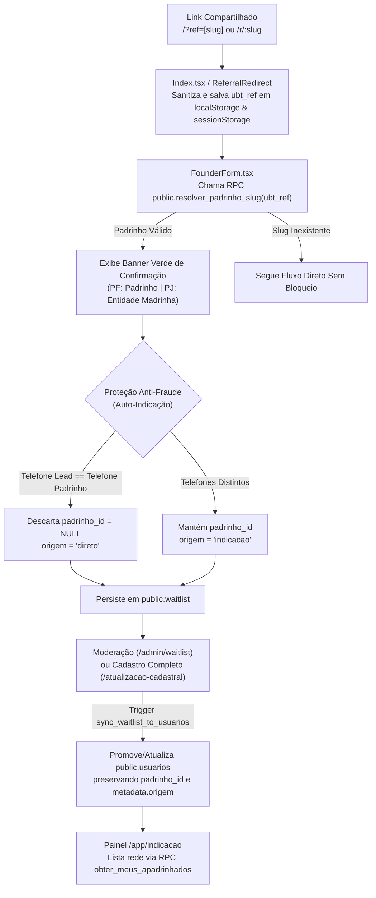

# Especificação Técnica Consolidada: Ecossistema de Apadrinhamento, Rastreabilidade e Governança Administrativa (Fases 1 e 2)

> **Ambientes Oficiais:**
> - **Produção:** [ubtservicos.vercel.app](https://ubtservicos.vercel.app) | Supabase Project: `bfqidoduceusbqlnrsol`
> - **Homologação:** [ubt-homologacao.vercel.app](https://ubt-homologacao.vercel.app) | Supabase Project: `xqujubbqcfqxkfczbidq`
>
> **Status:** HOMOLOGADO E CONGELADO EM PRODUÇÃO (CODE FREEZE)  
> **Tag de Release:** `v1.2.0-apadrinhamento-freeze` (Commit `885be9d` na branch `prod`)  
> **Documento Complementar:** [`especificacao_cadastro_fundador_enxuto.md`](./especificacao_cadastro_fundador_enxuto.md)  
> **Data de Consolidação:** 18 de Novembro de 2026  

---

## 1. Visão Geral e Regras de Negócio

### 1.1 Objetivo do Ciclo (Fases 1 e 2)
Construir a infraestrutura ponta a ponta de **captura, resolução segura, persistência relacional, auditoria administrativa e visibilidade para o usuário** do programa **Padrinho / Madrinha UBT**, cobrindo indicações bilaterais de **Pessoa Física (PF)** e **Pessoa Jurídica / Entidades (PJ / Associações)**.

Este ciclo garante que todo membro captado via link de indicação (`/?ref=[slug]` ou `/r/:slug`) carregue de forma íntegra o vínculo com o seu padrinho/madrinha (`padrinho_id`) desde a entrada na `public.waitlist` até a consolidação do usuário ativo em `public.usuarios`, deixando o banco de dados pronto para o acionamento do repasse financeiro na **Fase 3 (Split Financeiro)**.

### 1.2 Fluxo de Indicação Bilateral e Rastreabilidade de Origem



### 1.3 Regras de Negócio Estabelecidas

1. **Indicação Bilateral (PF ↔ PJ):**
   - Tanto usuários Pessoa Física (`role: 'tomador'` / `'prestador'`) quanto Entidades Jurídicas (`role: 'associacao'`) podem atuar como padrinhos/madrinhas e gerar links exclusivos com Vanity Slug.
   - Da mesma forma, tanto leads PF quanto leads PJ podem ser apadrinhados ao ingressarem por meio de um link com `?ref=`.
2. **Rastreabilidade Estrita de Origem (`origem`):**
   - Todo cadastro gravado em `public.usuarios.metadata.origem` recebe o marcador explícito:
     - `'indicacao'` quando vinculado a um `padrinho_id` válido.
     - `'direto'` quando ingressa sem indicação ou após bloqueio anti-fraude.
   - O campo relacional `padrinho_id` em `public.waitlist` e `public.usuarios` nunca é sobrescrito acidentalmente por atualizações posteriores se já houver um padrinho consolidado (`COALESCE(public.usuarios.padrinho_id, NEW.padrinho_id)`).
3. **Proteção Anti-Fraude Contra Auto-Indicação:**
   - Durante a submissão em `FounderForm.tsx`, o telefone informado pelo novo lead é normalizado (apenas dígitos) e comparado com `padrinho_telefone` retornado pela RPC `resolver_padrinho_slug`.
   - Caso haja coincidência numérica (`cleanLeadPhone === cleanPadrinhoPhone`), o front-end anula automaticamente `padrinho_id` para `null` e registra `origem: 'direto'`, impedindo que o usuário utilize o próprio link para autopromoção no futuro split financeiro.

---

## 2. Arquitetura de Banco de Dados (Homologação & Produção)

Todas as alterações de banco foram aplicadas de forma idempotente via migrações versionadas em `supabase/migrations/` nos projetos **Homologação (`xqujubbqcfqxkfczbidq`)** e **Produção (`bfqidoduceusbqlnrsol`)**, sem contaminação por dados fictícios em Produção.

### 2.1 Inventário de Migrações Aplicadas no Ciclo

| Arquivo de Migração | Responsabilidade Principal |
| :--- | :--- |
| `20261110171500_add_padrinho_waitlist_and_resolver_rpc.sql` | Adiciona `padrinho_id`, `referral_slug` e `idx_waitlist_padrinho_id` em `public.waitlist`; cria RPC `resolver_padrinho_slug(text)`; atualiza trigger `sync_waitlist_to_usuarios`. |
| `20261110174000_create_obter_meus_apadrinhados_rpc.sql` | Garante coluna `created_at` em `public.waitlist` e cria RPC `obter_meus_apadrinhados(uuid)`. |
| `20261111150000_fix_sync_waitlist_to_usuarios_role_mapping.sql` | Corrige erro `23514` (`usuarios_role_check`) mapeando papéis de entrada (`morador`, `turista`) para `tomador` na trigger `sync_waitlist_to_usuarios`. |
| `20261112123000_alter_system_logs_user_id_fkey_to_auth_users.sql` | Recria `system_logs_user_id_fkey` apontando para `auth.users(id) ON DELETE SET NULL`, permitindo telemetria com `user_id = NULL`. |
| `20261112183000_equalize_prod_schema_columns.sql` | Equaliza colunas entre ambientes: `associacao_id` em `associacao_membros`, `slug` em `waitlist`, e `razao_social`, `nome_fantasia`, `num_associados` em `usuarios`. |
| `20261117185000_fix_admin_rls_and_sync_waitlist.sql` | Equaliza `is_admin()` / `check_is_admin()` (`SECURITY DEFINER`), adiciona políticas RLS `admin_manage_usuarios` e `admin_manage_waitlist`, atualiza `usuarios_role_check` e torna `sync_waitlist_to_usuarios` resiliente a conflitos por ID, telefone ou e-mail. |

### 2.2 Alterações DDL em `public.waitlist`, `public.usuarios` e `public.associacao_membros`

- **`public.waitlist`:**
  - `padrinho_id uuid REFERENCES public.usuarios(id) ON DELETE SET NULL`
  - `idx_waitlist_padrinho_id` (índice B-Tree sobre `waitlist(padrinho_id)`)
  - `referral_slug text` e `slug text` (sincronizados com `COALESCE(referral_slug, referral_code)`)
  - `created_at timestamptz DEFAULT now()` (sincronizado com `created_at_utc` para registros legados)
- **`public.usuarios`:**
  - `padrinho_id uuid REFERENCES public.usuarios(id) ON DELETE SET NULL`
  - Colunas corporativas equalizadas para entidades PJ: `razao_social text`, `nome_fantasia text`, `num_associados text`
  - Check constraint `usuarios_role_check` equalizada aceitando: `('tomador', 'prestador', 'admin', 'superadmin', 'super_admin', 'cocoecia', 'associacao', 'user')`
- **`public.associacao_membros`:**
  - Coluna `associacao_id uuid` garantida e sincronizada com a coluna legada `association_id` presente em Produção.

### 2.3 Funções `SECURITY DEFINER` (Anti-Exposição PII)

#### A. `public.resolver_padrinho_slug(p_slug text)`
- **Finalidade:** Converter um código/slug textual em dados mínimos de vinculação sem liberar acesso irrestrito à tabela `public.usuarios` para visitantes anônimos.
- **Lógica de Busca:** Normaliza `lower(trim(p_slug))` e realiza `LEFT JOIN` entre `public.usuarios` e `public.waitlist` comparando em ordem case-insensitive contra:
  - `w.referral_slug`
  - `w.referral_code`
  - `u.referral_code`
  - `u.metadata->>'referral_slug'`
  - `u.metadata->>'referral_code'`
- **Retorno:** `TABLE (padrinho_id uuid, nome_exibicao text, tipo_padrinho text, padrinho_telefone text)` (`LIMIT 1`).
- **Permissões:** `GRANT EXECUTE ... TO anon, authenticated`.

#### B. `public.obter_meus_apadrinhados(p_padrinho_id uuid)`
- **Finalidade:** Alimentar a tela `/app/indicacao` e as abas de rede administrativa com a relação de indicados de um padrinho específico, sem expor telefones, CPFs ou e-mails na camada pública.
- **Retorno:** `TABLE (id uuid, nome text, tipo_cadastro text, status text, cadastro_completo boolean, criado_em timestamptz)` ordenados de forma decrescente por `COALESCE(w.created_at, w.created_at_utc, now())`.
- **Permissões:** `GRANT EXECUTE ... TO anon, authenticated`.

### 2.4 Trigger `public.sync_waitlist_to_usuarios()`

Executada em `AFTER INSERT OR UPDATE ON public.waitlist` com `SECURITY DEFINER`:

1. **Auto-Confirmação de E-mail:** Atualiza `auth.users.email_confirmed_at = COALESCE(email_confirmed_at, now())` para evitar falhas de login por e-mail pendente de confirmação.
2. **Vínculo de `user_id`:** Se `NEW.user_id` estiver nulo, tenta localizar o ID correspondente em `auth.users` pelo e-mail (respeitando a FK `waitlist_user_id_fkey`).
3. **Mapeamento Seguro de Papéis (Resolução do Erro `23514`):**
   - Se `tipo_cadastro IN ('pj', 'associacao', 'PJ')` ou `cnpj IS NOT NULL` ou `razao_social IS NOT NULL` $\rightarrow$ `v_role := 'associacao'`.
   - Se `NEW.role IN ('prestador', 'trabalhador')` $\rightarrow$ `v_role := 'prestador'`.
   - Se `NEW.role IN ('admin', 'superadmin', 'super_admin')` $\rightarrow$ `v_role := 'admin'`.
   - Demais papéis de entrada (como `'morador'`, `'turista'`) $\rightarrow$ `v_role := 'tomador'`.
4. **Resolução Multi-Chave de Duplicidades:**
   - Disparada quando `NEW.cadastro_completo = true` ou `NEW.status IN ('aprovado', 'approved', 'completo')`.
   - Localiza registro pré-existente em `public.usuarios` em cascata por `id = NEW.user_id`, `telefone = NEW.telefone` ou `LOWER(email) = LOWER(NEW.email)`.
   - Quando encontrado, executa `UPDATE` preservando papéis administrativos (`admin`, `superadmin`, `super_admin`) e mantendo `padrinho_id` já consolidado (`COALESCE(public.usuarios.padrinho_id, NEW.padrinho_id)`).
   - Quando inexistente, executa `INSERT` gravando `padrinho_id` e enriquecendo `metadata` com `origem`, `tipo_cadastro`, `role_waitlist`, `status_waitlist` e `cadastro_completo`.

### 2.5 Segurança, RLS e Integridade de Telemetria (`system_logs`)

1. **Resolução do Bloqueio RLS em `/admin/clientes`:**
   - **Diagnóstico:** Em Produção, a função `check_is_admin()` consultava `public.profiles` (onde o Super Admin `ubt.servicos@gmail.com` não possuía linha) e `is_admin()` comparava `role IN (..., 'super_admin')` (com underscore), enquanto a conta em `public.usuarios` possuía `role = 'superadmin'` (sem underscore). Consequentemente, todas as linhas de clientes (`role = 'tomador'`) eram ocultadas pelo RLS, retornando apenas a linha do próprio administrador.
   - **Solução (`20261117185000_fix_admin_rls_and_sync_waitlist.sql`):**
     - `public.is_admin()` e `public.check_is_admin()` reescritas com `SECURITY DEFINER SET search_path = public` (prevenindo erro de recursão `42P17`), verificando o e-mail administrativo no JWT (`ubt.servicos@gmail.com`, `admin@ubt.app`), os papéis `('admin', 'superadmin', 'super_admin', 'operator', 'financeiro', 'moderador')` em `public.usuarios` e fallback em `auth.users` / `public.profiles`.
     - Políticas explícitas `admin_manage_usuarios` (em `public.usuarios`) e `admin_manage_waitlist` (em `public.waitlist`) criadas com `FOR ALL TO authenticated USING (public.is_admin()) WITH CHECK (public.is_admin())`.
2. **Correção de Logs Anônimos (`409 Conflict` em `system_logs`):**
   - Alterada `system_logs_user_id_fkey` para referenciar `auth.users(id) ON DELETE SET NULL`, permitindo que eventos disparados antes da autenticação (como na tela `/login`) persistam normalmente com `user_id = null`.

---

## 3. Camada de Front-End e Experiência do Usuário

### 3.1 Captura Resiliente na Entrada (`src/pages/Index.tsx` & `src/App.tsx`)
- **`src/pages/Index.tsx`:** No carregamento inicial (`useEffect`), lê `?ref=` de `window.location.search`, remove barras, contrabarras e espaços residuais (`rawRef.trim().replace(/[\\/\s]/g, "")`) e armazena de forma redundante em:
  - `localStorage.setItem("ubt_ref", cleanRef)`
  - `sessionStorage.setItem("ubt_ref", cleanRef)`
- **`src/App.tsx` (`ReferralRedirect`):** A rota curta `/r/:slug` salva o `slug` tanto em `sessionStorage` quanto em `localStorage` sob a chave `ubt_ref` e redireciona imediatamente para `/?ref=${encodeURIComponent(slug)}#cadastro-fundadores-cap`.

### 3.2 Resolução, Banner e Bloqueio Anti-Fraude (`src/components/FounderForm.tsx`)
- No mount do formulário, recupera o slug (priorizando a URL `?ref=` e usando `localStorage`/`sessionStorage` como fallback) e executa `supabase.rpc("resolver_padrinho_slug", { p_slug: cleanSlug })`.
- Quando resolvido com sucesso, exibe **banner esmeralda de confirmação** acima do formulário:
  - Para Padrinho PF: `"Convidado por [Nome]"` — *"Membro Fundador Padrinho UBT"*.
  - Para Entidade PJ: `"Convidado por [Nome]"` — *"Entidade Madrinha: [Nome]"*.
- Na submissão (`onSubmit`), valida se `cleanLeadPhone === cleanPadrinhoPhone`:
  - Em caso de tentativa de auto-indicação, anula `finalPadrinhoId = null` e envia `origem: "direto"`.
  - Caso contrário, envia `padrinho_id: finalPadrinhoId` e `origem: "indicacao"` no payload de `public.waitlist`.
- No modal de boas-vindas pós-cadastro, exibe o feedback visual: *"Apadrinhado com sucesso por: [Nome do Padrinho]"*.

### 3.3 Feedback na Esteira de Atualização (`src/pages/AtualizacaoCadastral.tsx`)
- Ao carregar os dados do lead na esteira `/atualizacao-cadastral`, se `waitlist.padrinho_id` estiver preenchido, resolve e exibe um banner informativo no topo do wizard confirmando o vínculo de apadrinhamento com o nome do padrinho ou entidade madrinha.

### 3.4 Painel do Usuário — "Sua Rede de Apadrinhados" (`src/pages/IndicacaoPage.tsx`)
- A página `/app/indicacao` resolve o usuário ativo (por parâmetro `tel`, `supabase.auth.getUser()`, `getSession()` ou `onAuthStateChange`) e invoca `supabase.rpc("obter_meus_apadrinhados", { p_padrinho_id })`.
- Renderiza o card **Sua Rede de Apadrinhados** com:
  - **KPIs Resumidos:** Total de Indicados, Cadastros Completos/Ativos e Pendentes na Esteira.
  - **Lista Detalhada:** Nome de exibição, tag diferenciada `PF` ou `PJ`, status de completude cadastral e data de ingresso formatada, além de estado vazio amigável incentivando o primeiro compartilhamento do link/QR Code.

### 3.5 Auditoria Administrativa e Resiliência (`/admin/*`)

| Tela Administrativa | Arquivo | Recursos de Auditoria e Resiliência Implementados |
| :--- | :--- | :--- |
| **Waitlist** | `src/pages/admin/AdminWaitlistPage.tsx` | Enriquecimento dos leads resolvendo `padrinho_id` em `public.usuarios`; coluna de origem com badge esmeralda (`[Nome Padrinho] · PF/PJ`) ou badge neutra (`Direto (Sem Padrinho)`); card de origem no modal de detalhes. |
| **Clientes (PF)** | `src/pages/admin/AdminClientesPage.tsx`<br/>`src/pages/admin/AdminClienteDetailPage.tsx` | Queries auxiliares isoladas via `Promise.allSettled` (garantindo que nenhuma falha secundária bloqueie a listagem principal); suporte bidirecional a `associacao_id` e `association_id`; coluna de origem (`Padrinho` vs `Direto`); seção dedicada de **Apadrinhados** na página de detalhes do cliente via `obter_meus_apadrinhados`. |
| **Entidades (PJ)** | `src/pages/admin/AdminEntidadesPage.tsx` | Importação corrigida dos ícones `Users`, `User`, `Handshake`; exibição da origem/padrinho da entidade e listagem da rede de apadrinhados da associação no modal de detalhes via `obter_meus_apadrinhados`. |

### 3.6 Higienização de Telemetria (`AnalyticsService.ts` & `LoggingService.ts`)
- Criada e aplicada a função utilitária `isValidUuid` antes de persistir eventos em `analytics_events` e `system_logs`. Valores não-UUID, vazios ou inválidos são convertidos em `null`, evitando erros `409 Conflict` por violação de chave estrangeira durante sessões anônimas.

---

## 4. Qualidade e Testes Automatizados

A bateria de validação da versão congelada (`v1.2.0-apadrinhamento-freeze`) foi executada na íntegra antes do release freeze:

```text
================================================================================
RELATÓRIO DE VALIDAÇÃO DA BASELINE CONGELADA (v1.2.0-apadrinhamento-freeze)
================================================================================
Type-check (TypeScript):    npx tsc --noEmit     -> 0 erros (PASS)
Suíte de Testes (Vitest):   npm test -- --run    -> 20/20 arquivos, 236/236 testes PASS
Build de Produção (Vite):   npm run build        -> Sucesso em 28.61s (dist/ gerado)
Commit em Produção (prod):  885be9d              -> Sincronizado com origin/prod
Tag de Congelamento:        v1.2.0-apadrinhamento-freeze -> Publicada em origin
================================================================================
```

### Cobertura Específica de Apadrinhamento (`src/test/referral/referralResolution.test.ts`)
Os 7 cenários unitários implementados validam:
1. Resolução bem-sucedida de slug válido retornando `padrinho_id`, `nome_exibicao` e `tipo_padrinho`.
2. Sanitização de slugs com barras e espaços residuais (ex.: `" /associacao-ubt/ \n"` $\rightarrow$ `"associacao-ubt"`).
3. Tratamento gracioso de slug inexistente retornando `null` sem exceções.
4. Tratamento gracioso de erro de rede/RPC retornando `null`.
5. Bloqueio de auto-indicação quando o telefone do lead coincide com o telefone do padrinho (`padrinho_id: null`, `origem: "direto"`, `isAutoIndicacao: true`).
6. Persistência de `origem: "indicacao"` e `padrinho_id` válido quando telefones são distintos.
7. Persistência de `origem: "direto"` e `padrinho_id: null` na ausência de padrinho.

---

## 5. Baseline Congelada e Próximo Passo (Fase 3 — Split Financeiro)

### 5.1 Política de Code Freeze
- A tag anotada **`v1.2.0-apadrinhamento-freeze`** marca a linha de base imutável das Fases 1 e 2 em Produção (`885be9d`).
- **Bloqueio de Alterações:** Nenhuma modificação nos diretórios `src/` ou `supabase/` deve ser promovida para a branch `prod` até a abertura formal da **Fase 3 (Split Financeiro)**.

### 5.2 Arquitetura Preparada para a Fase 3
O modelo de dados de split (`supabase/migrations/20260904_split_padrinho_split.sql`) já dispõe das colunas necessárias em `public.split_config` e `public.pagamentos_split`:
- **`public.split_config`:**
  - `padrinho_tomador_pct`: `0.500` (0,5% destinado ao padrinho do tomador)
  - `padrinho_prestador_pct`: `0.500` (0,5% destinado ao padrinho do prestador)
- **`public.pagamentos_split`:**
  - `godparent_tomador_id uuid` / `godparent_tomador_amount numeric`
  - `godparent_prestador_id uuid` / `godparent_prestador_amount numeric`

Na **Fase 3**, o motor financeiro e o webhook de liquidação consultarão `public.usuarios.padrinho_id` tanto para o `tomador_id` quanto para o `prestador_id` envolvidos na transação, populando automaticamente `godparent_tomador_id` e `godparent_prestador_id` em `pagamentos_split` e efetuando o crédito/redirecionamento do respectivo repasse quando o padrinho existir e estiver ativo (ou revertendo a cota conforme regra de negócio quando `padrinho_id IS NULL`).


---

## 6. Fase 3 — Split Financeiro de Apadrinhamento, Contingenciamento por Chave PIX e Mercado Pago (Produção)

> **Status:** HOMOLOGADO E PROMOVIDO PARA PRODUÇÃO  
> **Tag de Release:** `v1.3.0-split-apadrinhamento-prod`  
> **Migração Aplicada (Homologação & Produção):** `supabase/migrations/20261119120000_fase3_split_apadrinhamento_contingenciamento.sql`  
> **Edge Function Implantada (Homologação & Produção):** `supabase/functions/payment-gateway/index.ts`  
> **Data de Promoção:** 19 de Novembro de 2026  

### 6.1 Regras de Alocação e Contingenciamento no Split
- **Sem Padrinho (`padrinho_id IS NULL`):** A cota de 0,5% segue a regra padrão destinada ao fundo de reserva da plataforma, com `status_repasse_* = 'nao_aplicavel'`.
- **Com Padrinho e COM Chave PIX cadastrada:** Preenche `godparent_tomador_id` / `godparent_prestador_id`, aloca os 0,5% correspondentes e define `status_repasse_* = 'pendente_repasse'` (pronto para liquidação).
- **Com Padrinho e SEM Chave PIX cadastrada:** Preenche `godparent_tomador_id` / `godparent_prestador_id`, retém os 0,5% integralmente para o padrinho (sem redirecionar ao fundo de reserva) e define `status_repasse_* = 'contingenciado'`.
- **Liberação Automática:** Assim que o padrinho (ou o administrador) salva uma `chave_pix` válida em `public.usuarios`, a trigger `trg_liberar_contingenciamento_pix` converte automaticamente todos os repasses `'contingenciado'` daquele padrinho para `'pendente_repasse'`.

### 6.2 Objetos de Banco de Dados da Fase 3
- **Colunas em `public.usuarios`:** `chave_pix`, `tipo_chave_pix`, `possui_mercadopago boolean NOT NULL DEFAULT false` (com backfill a partir de `waitlist`, `profiles.pix_key` e `marketplace_accounts`).
- **Colunas e Constraints em `public.pagamentos_split`:** `tomador_id`, `status_repasse_godparent_tomador`, `status_repasse_godparent_prestador`, `repasse_godparent_tomador_em`, `repasse_godparent_prestador_em`, FKs para `public.usuarios(id)`, check constraints (`'nao_aplicavel'`, `'pendente_repasse'`, `'contingenciado'`, `'pago'`) e índices `idx_pagamentos_split_godparent_tomador` / `idx_pagamentos_split_godparent_prestador`.
- **Funções e Triggers (`SECURITY DEFINER`):**
  - `public.usuario_possui_chave_pix(uuid)`
  - `public.resolve_godparent_split_contingency()` + trigger `trg_resolve_godparent_split_contingency` (`BEFORE INSERT OR UPDATE ON pagamentos_split`)
  - `public.liberar_contingenciamento_ao_salvar_pix()` + trigger `trg_liberar_contingenciamento_pix` (`AFTER INSERT OR UPDATE OF chave_pix ON usuarios`)
  - `public.obter_resumo_financeiro_apadrinhamento(p_padrinho_id uuid)`
  - `public.salvar_chave_pix_usuario(p_user_id uuid, p_chave_pix text, p_tipo_chave_pix text)`
  - `public.atualizar_status_mercadopago_usuario(p_user_id uuid, p_possui boolean)`
- **RLS:** Política `godparent_read_own_pagamentos_split` em `public.pagamentos_split` permitindo leitura autenticada aos participantes (`godparent_tomador_id`, `godparent_prestador_id`, `godparent_id`, `tomador_id`, `provider_id`) e administradores (`is_admin()`).

### 6.3 Motor de Split, UI do Usuário e Painéis Administrativos
- **Motor Puro (`src/lib/finance/splitEngine.ts`):** Funções `resolveGodparentAllocation` e `releaseContingencyRepasses` cobertas por 5 testes unitários dedicados em `src/test/split/godparentSplit.test.ts` (suíte total: **21 arquivos, 241 testes PASS**).
- **Gateway (`supabase/functions/payment-gateway/index.ts`):** Função `resolveGodparentSplitContext` resolve automaticamente os padrinhos do tomador e do prestador no servidor, verifica chave PIX e grava os status de contingenciamento em `pagamentos_split`.
- **`/app/indicacao` (`IndicacaoPage.tsx`):** Cards financeiros de **Ganhos por Apadrinhamento** (Saldo Liberado/Disponível, Saldo Contingenciado e Histórico dos Repasses) + banner de alerta/cadastro rápido `PixContingencyBanner.tsx`.
- **`/app/gerenciar` (`GerenciarPage.tsx` + `MercadoPagoOnboardingCard.tsx`):** Alert compacto no **topo** da página com identidade visual gamer/bets (`#0b0f14` / `#111827`, borda neon âmbar/esmeralda) que expande suavemente ao clicar, explicando que **a abertura da conta no Mercado Pago é fundamental para movimentar e receber na plataforma e é totalmente gratuita**, com CTA oficial (`https://www.mercadopago.com.br/hub/registration/landing`), confirmação *"Já possuo conta"* e cadastro rápido de chave PIX.
- **`/admin/clientes`, `/admin/clientes/:id` e `/admin/entidades`:** Alerta **`⚠️ Sem chave PIX`**, editor rápido inline `AdminPixQuickEditor.tsx` e filtro toggle **`⚠️ Sem chave PIX`** nas barras de filtros de Clientes e Entidades.


---

## 7. Ecossistema Côco & Cia, Slug/ID UBT Editável e Operação em Campo (Produção)

> **Status:** HOMOLOGADO E PROMOVIDO PARA PRODUÇÃO  
> **Tag de Release:** `v1.4.0-coco-cia-prod`  
> **Ambientes:** Produção ([ubtservicos.vercel.app](https://ubtservicos.vercel.app) / `bfqidoduceusbqlnrsol`) e Homologação ([ubt-homologacao.vercel.app](https://ubt-homologacao.vercel.app) / `xqujubbqcfqxkfczbidq`)  
> **Data de Promoção:** 19 de Novembro de 2026  

### 7.1 Migrações Aplicadas de Forma Idempotente (Homologação & Produção — Apenas DDL/Funções/RLS)

| Arquivo de Migração | Responsabilidade Principal |
| :--- | :--- |
| `20261119171000_fix_coco_dicas_materiais_rls.sql` | Garante colunas `is_active`/`updated_at`, função `public.can_manage_coco_manuais()` e RLS completa para CRUD em `public.coco_dicas_materiais`. |
| `20261119175500_simplify_coco_colaboradores.sql` | Torna `veiculo` e `bairro_atuacao` opcionais em `public.coco_colaboradores`, adiciona `is_ativo`/`updated_at` e policy `coco_colaboradores_manage_policy`. |
| `20261119181000_restructure_coco_frota.sql` | Adiciona `colaboradores_ids uuid[]`, `hora_saida` e `expectativa_retorno` em `public.coco_caminhoes` e policy `coco_caminhoes_manage_policy`. |
| `20261119201000_coco_colaboradores_perfil_e_requerimento.sql` | Adiciona `user_id`, `perfil`, `status_aprovacao`, `aprovado_por`, `aprovado_em` em `public.coco_colaboradores`; amplia `usuarios_role_check`; cria RPC `gerenciar_vinculo_colaborador_coco` e policies de requerimento próprio. |
| `20261119210000_coco_slug_perfil_prestador_coleta.sql` | Adiciona `ubt_slug` e perfil `'prestador'` em `public.coco_colaboradores`; adiciona `coletado_por`/`coletado_por_nome` em `public.coco_pontos`; cria `is_coco_field_collaborator()`, `resolver_usuario_por_slug_ubt(text)` e `confirmar_coleta_ponto_coco(uuid, uuid)`; atualiza RLS de `coco_pontos` e `coco_caminhoes`. |
| `20261119213000_atualizar_meu_slug_ubt.sql` | Cria RPC `SECURITY DEFINER` `public.atualizar_meu_slug_ubt(text)` com validação de formato, checagem de unicidade case-insensitive em `public.usuarios.referral_code` e sincronização automática em `public.coco_colaboradores.ubt_slug`. |

### 7.2 Geolocalização Local-First e Endereço Completo Editável
- **Tratamento Seguro da Geocoding API (`src/lib/googleMapsConfig.ts`, `src/lib/geoService.ts`, `src/hooks/useGeolocation.ts`):**
  - Introduzida flag `GOOGLE_GEOCODING_ENABLED` (default `false`) e circuit-breaker em memória contra `REQUEST_DENIED`, eliminando erros de Geocoding API no console.
  - `reverseGeocode(lat, lng)` opera em cascata local-first: **Cache local** $\rightarrow$ **`ceps_ubatuba` mais próximo** $\rightarrow$ **OpenStreetMap Nominatim** (`zoom=18&addressdetails=1&accept-language=pt-BR`, retornando logradouro, número aproximado e bairro em Ubatuba - SP) $\rightarrow$ Google Geocoder (apenas se explicitamente ativado) $\rightarrow$ fallback estruturado por bairro + coordenadas.
- **Botão Alvo (`target`) Editável em `/app/coco` (`src/pages/CocoPage.tsx`):**
  - Captura GPS de alta precisão (`enableHighAccuracy: true`), resolve o endereço completo via `reverseGeocode` e foca o campo mantendo-o 100% editável para o Tomador ajustar número exato ou ponto de referência.

### 7.3 Manuais Educativos, Colaboradores, Perfis e RBAC do Menu Côco & Cia
- **Manuais Educativos (`/admin/coco/manuais`):** CRUD completo persistido em `public.coco_dicas_materiais` (criar, editar, ativar/inativar, excluir e limpeza de duplicados) protegido por `public.can_manage_coco_manuais()`.
- **Colaboradores (`/admin/coco/colaboradores`):**
  - Formulário simplificado com **Nome Completo** e **Telefone / WhatsApp** com máscara e validação REGEX (`(XX) XXXXX-XXXX`).
  - Vínculo administrativo por **ID / Slug UBT** (`resolver_usuario_por_slug_ubt`), removendo a opção pública de auto-vinculação por placa de caminhão em `CocoOnboardingPage.tsx`.
  - Bloco de **Requerimentos Pendentes** com aprovação/rejeição via `gerenciar_vinculo_colaborador_coco`.
  - **Perfis e RBAC (`AdminLayout.tsx`, `AdminRoute.tsx`, `App.tsx`):**
    - **Superadmin UBT e Alta Gestão (`alta_gestao` / `cocoecia-dirigentes`):** visão completa das 8 rotas do menu **Côco & Cia** (Dashboard, Mapa Operacional, Agenda, Manuais, Captação, Frota, Colaboradores e Configurações).
    - **Colaborador Administrativo (`colaborador_administrativo` / `cocoecia-colaborador`):** acesso restrito exclusivamente às 5 páginas operacionais (**Mapa**, **Agenda**, **Manuais**, **Colaboradores** e **Frota**).
    - **Prestador (`prestador`):** **sem acesso** ao painel `/admin/coco/*`; mantém seu acesso normal de `tomador` no app e opera rotas/coletas exclusivamente em `/app/prestador/coco/online`.
    - Removido papel `"tomador"` das rotas administrativas `/admin/coco/*` e restringido o atalho **Côco & Cia** em `/app/prestador/home` apenas a colaboradores ativos em `public.coco_colaboradores`.

### 7.4 Reestruturação de Frota (`/admin/coco/frota`)
- Removida completamente a chave PIX do caminhão em `/admin/coco/frota`, `CocoOnlinePage.tsx` e `ConfigCocoPage.tsx`.
- Implementado componente **`DualListboxColaboradores.tsx`** (duas colunas responsivas: *Disponíveis* com busca rápida e *Vinculados ao Caminhão* com remoção rápida), persistindo `colaboradores_ids` em `public.coco_caminhoes`.
- Adicionada ordenação sequencial de **Rotas Bairro a Bairro** (`1º → 2º → ...` com controles subir/descer) e horários de **Saída** (`hora_saida`) e **Expectativa de Retorno** (`expectativa_retorno`).

### 7.5 Operação em Campo, Confirmação ao Tomador, Visual Gamer/Bets e Slug Editável
- **Operação em `/app/prestador/coco/online` (`CocoOnlinePage.tsx`):**
  - Corrigida importação de `useSimpleToast`.
  - Colaboradores vinculados via `colaboradores_ids` ou `prestador_id` visualizam a rota ordenada, horários de saída/retorno e pontos pendentes ordenados conforme a sequência de bairros, podendo clicar em **OK / Confirmar Coleta** em cada endereço (`confirmar_coleta_ponto_coco`).
- **Confirmação ao Tomador em `/app/coco` (`CocoPage.tsx`):**
  - Ao confirmar a coleta, `public.coco_pontos` é atualizado (`status = 'coletado'`, `coletado_at`, `coletado_por`, `coletado_por_nome`) e uma notificação é gravada em `public.in_app_notifications` para o `tomador_id`.
  - A aba **Acompanhar** e o listener realtime exibem banner verde neon confirmando que o pacote foi recolhido no endereço informado.
- **Identidade Visual Gamer / Bets:**
  - Aplicada em `/app/coco`, `/app/prestador/coco/online` e `/app/prestador/coco/onboarding`: fundo dark profundo (`#0B0F14` / `#111827`), bordas neon esmeralda (`rgba(16,185,129,0.35)`), badges e tabs em `uppercase` com `tracking-wider` e alto contraste.
- **ID / Slug UBT Genérico e Editável (`/app/config/perfil` — `ConfigPerfilPage.tsx`):**
  - Card institucional neutro **`SEU ID / SLUG NA PLATAFORMA UBT`** (sem menções à Côco & Cia), com botões **Copiar** e **Editar** (sanitização automática, validação de formato e unicidade via `atualizar_meu_slug_ubt`).

### 7.6 Baseline de Produção (`v1.4.0-coco-cia-prod`)
- **Type-check:** `npx tsc --noEmit` $\rightarrow$ `0` erros.
- **Testes:** `npm test -- --run` $\rightarrow$ `21/21` arquivos, `241/241` testes PASS.
- **Build:** `npm run build` $\rightarrow$ sucesso.
- **Tag de Release:** `v1.4.0-coco-cia-prod` publicada em `origin/prod`.


---

## 8. Pagamentos do Módulo Mototaxistas (PIX Presencial no Motorista, Wallet de Cartões, Repasse de Taxas e Webhook Mercado Pago — `v1.5.0-mototaxi-pagamentos-prod`)

> **Status:** HOMOLOGADO E PROMOVIDO PARA PRODUÇÃO  
> **Tag de Release:** `v1.5.0-mototaxi-pagamentos-prod`  
> **Ambientes:** Produção ([ubtservicos.vercel.app](https://ubtservicos.vercel.app) / `bfqidoduceusbqlnrsol`) e Homologação ([ubt-homologacao.vercel.app](https://ubt-homologacao.vercel.app) / `xqujubbqcfqxkfczbidq`)  
> **Data de Promoção:** 24 de Novembro de 2026  

### 8.1 Migração Idempotente Aplicada (Homologação & Produção — Apenas DDL/RLS/Taxas Padrão)

| Arquivo de Migração | Responsabilidade Principal |
| :--- | :--- |
| `20261124120000_mototaxi_payments_wallet_fees_rls.sql` | Registra `taxa_pix` (`0.99%`) e `taxa_cartao` (`4.98%`) via `ON CONFLICT DO NOTHING` em `public.system_settings`; adiciona colunas `base_amount`, `payment_method_fee_pct`, `payment_method_fee_amount` e `payment_method` em `public.pagamentos_split`; cria `public.mp_customer_wallets` com RLS restrita ao dono (`auth.uid() = user_id`) e `service_role`; endurece RLS de `public.mototaxi_corridas` e `public.pagamentos_split` e executa `NOTIFY pgrst, 'reload schema'` / `'reload config'`. |

### 8.2 Cálculo Canônico, Transparência de Taxas ao Tomador e Split Mercado Pago
- **Taxas dinâmicas (`system_settings` + `FinancialFeeService.ts` + `payment-gateway/index.ts`):**
  - `taxa_pix` (`0,99%`) e `taxa_cartao` (`4,98%`) são lidas dinamicamente de `public.system_settings` com normalização segura (sem multiplicar percentuais `< 1%` como `0.99` por `100`).
  - Na tela de pagamento do Passageiro (`MototaxiTomador.tsx` / `CompletedScreen`), são exibidos de forma explícita: **Valor base da corrida**, **Taxa do meio de pagamento arcada pelo Tomador** (comparando PIX vs. Cartão já nos botões de escolha) e **Total a pagar** (`base + taxa`).
  - No servidor (`supabase/functions/payment-gateway/index.ts`), o valor canônico da corrida é sempre obtido de `public.mototaxi_corridas` (`final_price ?? estimated_price`). O split de 7 vias incide sobre `base_amount`, preservando integralmente **90% líquidos da tarifa base ao Mototaxista** (`prestador_pct`), enquanto `transaction_amount` enviado ao Mercado Pago inclui a taxa do meio de pagamento e `application_fee` (no modo `seller_oauth_split`) equivale a `total_amount - prestador_amount` (cota de 10% do ecossistema + cobertura da taxa do gateway).
  - O detalhamento financeiro completo é persistido em `public.pagamentos_split` (`base_amount`, `payment_method_fee_pct`, `payment_method_fee_amount`, `payment_method`, `total_amount`, `provider_amount`, `application_fee_amount`).

### 8.3 PIX Presencial Automático no Motorista, `notification_url` e `payment-webhook`
- **Geração automática e idempotência por tentativa (`PrestadorMototaxiActive.tsx`):**
  - Ao concluir a corrida (`status = 'completed'`) e o Passageiro selecionar **PIX**, a tela do Motorista dispara automaticamente `create_mototaxi_pix_charge` e exibe em destaque o **QR Code PIX** (PNG base64 do Mercado Pago com fallback SVG), o código Copia e Cola e o valor total com taxa PIX.
  - Se já existir cobrança PIX pendente e não expirada em `mototaxi_corridas`, ela é reaproveitada; em novas tentativas ou após expiração, um novo `payment_attempt_id` (`crypto.randomUUID()`) é gerado, eliminando colisões de idempotência do antigo `ride.id` fixo.
  - Removidos o botão de baixa manual no cliente (`UPDATE status = 'paid'`) e o código morto de pagamento em dinheiro (`cash`).
- **Webhook real e sincronização do Tomador (`payment-gateway`, `payment-webhook`, `MototaxiTomador.tsx`):**
  - `payment-gateway` envia explicitamente `notification_url` (`MP_WEBHOOK_URL` ou `${supabaseUrl}/functions/v1/payment-webhook`) no payload `POST /v1/payments`.
  - `payment-webhook` (deployado com `--no-verify-jwt`, autenticado por HMAC-SHA256 `x-signature` + verificação server-side na API do MP) atualiza `pagamentos_split` (`status = 'approved'`, `gateway_status = 'approved'`, `gateway_status_detail`) e `mototaxi_corridas` (`status = 'paid'`, `pix_charge_status = 'approved'`, preservando `final_price` com a tarifa base `base_amount`).
  - `MototaxiTomador.tsx` trata `status === 'paid'` tanto via Realtime quanto via polling, encerra o polling ao entrar em `rating` e recupera automaticamente corrida ativa ou concluída pendente de pagamento caso a página seja recarregada.

### 8.4 Carteira de Cartões Salvos (Wallet) e Blindagem do `CheckoutUniversal.tsx`
- **API oficial de Clientes e Cartões do Mercado Pago (`/v1/customers` e `/v1/customers/{customer_id}/cards`):**
  - `public.mp_customer_wallets` vincula `(user_id, environment, collector_scope)` ao `mp_customer_id`, suportando tanto a rota `seller_oauth_split` quanto `platform_fallback`.
  - Novas actions autenticadas em `payment-gateway`: `list_saved_cards`, `save_card`, `delete_saved_card`, além de suporte em `create_payment_intent` para pagamento com cartão salvo (`saved_card_id` + `payer.type = "customer"`) e salvamento não-bloqueante de novo cartão após aprovação (`save_card: true` + `save_card_token` separado).
- **Blindagem e UX em `CheckoutUniversal.tsx`:**
  - Eliminado o crash síncrono no render quando `VITE_MP_ENVIRONMENT` não está presente no bundle (resolução segura via `get_checkout_config` e fallback por hostname); em Sandbox, aceita credenciais `APP_USR-` e `TEST-` sem falso bloqueio de `live_mode` (mantendo fail-closed em Produção).
  - Permite alternar entre **Carteira (cartões salvos)** — selecionando cartão salvo e informando apenas o CVV para tokenização via SDK MP (`createCardToken({ cardId, securityCode })`) — e **Novo cartão** (PCI Fields com checkbox para salvar na carteira).
  - Só avança `onSuccess` quando `status === 'approved'`, trata `in_process`/`pending` como aguardando confirmação assíncrona do webhook e traduz recusas (`status_detail`) do Mercado Pago.

### 8.5 Endurecimento de RLS e Isolamento de Produção (`bfqidoduceusbqlnrsol`)
- **`public.mototaxi_corridas`:** removidas policies permissivas abertas ao público/anônimos; `UPDATE` autenticado exige participação na corrida e `WITH CHECK (... AND status <> 'paid')`, mantendo promoção para `'paid'` exclusiva de `service_role` (Edge Functions).
- **`public.pagamentos_split`:** removida a policy de `INSERT` aberto para `authenticated` (escrita restrita a `service_role`).
- **`public.mp_customer_wallets`:** `SELECT` restrito ao próprio `auth.uid() = user_id` e escrita exclusiva de `service_role`.
- **Isolamento de ambientes:** Produção (`bfqidoduceusbqlnrsol` / `ubtservicos.vercel.app`) mantém `MP_ENVIRONMENT=production` e credenciais reais exclusivas, sem qualquer secret ou dado de Sandbox/Homologação (`xqujubbqcfqxkfczbidq`).
- **Edge Functions em Produção:** `payment-gateway` (`v10`, `ACTIVE`, `verify_jwt: true`) e `payment-webhook` (`v5`, `ACTIVE`, `verify_jwt: false`).
- **Validação & Release (`v1.5.0-mototaxi-pagamentos-prod`):** `npx tsc --noEmit` (`0` erros), `npm test -- --run` (`21/21` arquivos, `241/241` testes PASS) e `npm run build` OK.


---

## 9. Reestruturação Cadastral de Clientes e Entidades (PJ) no Superadmin, Bloqueio, Exclusão com Senha e Histórico Auditável (`v1.6.0-admin-clientes-entidades-prod`)

> **Status:** HOMOLOGADO E PROMOVIDO PARA PRODUÇÃO  
> **Tag de Release:** `v1.6.0-admin-clientes-entidades-prod`  
> **Ambientes:** Produção ([ubtservicos.vercel.app](https://ubtservicos.vercel.app) / `bfqidoduceusbqlnrsol`) e Homologação ([ubt-homologacao.vercel.app](https://ubt-homologacao.vercel.app) / `xqujubbqcfqxkfczbidq`)  
> **Data de Promoção:** 24 de Novembro de 2026  

### 9.1 Migração Idempotente e Edge Function de Exclusão Segura (Homologação & Produção)

| Artefato | Responsabilidade Principal |
| :--- | :--- |
| `20261124140000_admin_clientes_bloqueio_e_auditoria.sql` | Adiciona colunas de controle de bloqueio em `public.usuarios` (`is_blocked`, `blocked_until`, `block_duration_label`, `blocked_reason`, `blocked_by`, `blocked_at`), índice parcial `idx_usuarios_is_blocked`, cria a RPC `SECURITY DEFINER` `public.admin_bloquear_desbloquear_cliente(p_user_id, p_action, p_duration, p_reason)` com gravação automática em `public.admin_audit_logs`, concede `EXECUTE` a `authenticated` e executa reload de schema/config no PostgREST. |
| `supabase/functions/admin-delete-client/index.ts` | Edge Function (`verify_jwt: true`) que autentica o chamador, confirma permissão de `admin`/`super_admin`, valida a senha atual do Superadmin via Supabase Auth (`signInWithPassword` com `SUPABASE_ANON_KEY`), grava trilha completa de auditoria em `public.admin_audit_logs` e remove definitivamente o cadastro (`public.usuarios`, `public.profiles` e `auth.users` via `service_role`), impedindo autoexclusão administrativa. |

### 9.2 Listagens 100% Cadastrais, Paleta Preto & Cinza, Ordenação (`Order by`) e Congelamento Horizontal (`sticky`)
- **Remoção de dados financeiros:** as telas `/admin/clientes` (`AdminClientesPage.tsx`), `/admin/clientes/:id` (`AdminClienteDetailPage.tsx`), `/admin/entidades` (`AdminEntidadesPage.tsx`) e `/admin/entidades/:id` (`AdminEntidadeDetailPage.tsx`) passaram a operar com foco 100% cadastral, sem exibição de saldos, extratos ou valores monetários.
- **Identidade visual neutra preto e cinza:** adotada paleta de alto contraste (`#09090B` / `bg-zinc-950`, `#121215` / `bg-zinc-900`, bordas `border-zinc-800`, textos `text-zinc-100` / `text-zinc-400`), reservando cores de acento exclusivamente para semântica funcional (esmeralda para ativo/sucesso, vermelho para bloqueio/exclusão e âmbar para alertas/incompleto).
- **Ordenação clicável em todos os cabeçalhos (`Order by`):** todos os cabeçalhos de coluna de `/admin/clientes` e `/admin/entidades` alternam ordenação crescente/decrescente com indicador visual (`ArrowUpDown`, `ArrowUp`, `ArrowDown`).
- **Congelamento horizontal (`sticky`) das duas primeiras colunas:**
  - `/admin/clientes`: **1ª coluna (`Nome`)** fixa em `sticky left-0` (`240px`) e **2ª coluna (`Slug`)** fixa em `sticky left-[240px]` (`170px`).
  - `/admin/entidades`: **1ª coluna (`Entidade / Razão Social`)** fixa em `sticky left-0` (`260px`) e **2ª coluna (`CNPJ`)** fixa em `sticky left-[260px]` (`175px`), seguidas por `Slug`, `Responsável Legal`, `Contato`, `Cadastro`, `Entidade desde`, `Status` e `Ações`.
  - Ambas as tabelas usam `overflow-x-auto`, `border-separate border-spacing-0`, fundos sólidos opacos (`bg-zinc-950` no `<thead>`, `bg-zinc-900` / `group-hover:bg-zinc-800` no `<tbody>`, e tom sólido escuro avermelhado para linhas bloqueadas), `z-30` / `z-20` e divisor direito `border-r border-zinc-800` na 2ª coluna fixa.
- **Filtro de Chave PIX em 3 estados e datas de entrada:**
  - Seletor unificado `Chave PIX: Todos` / `Com chave PIX` / `Sem chave PIX` em ambas as telas.
  - Colunas dedicadas **`Cliente desde`** (`/admin/clientes`) e **`Entidade desde`** (`/admin/entidades`) formatadas em `dd/MM/yyyy` e ordenáveis.

### 9.3 Páginas Cadastrais Dedicadas (`/admin/clientes/:id` e `/admin/entidades/:id`)
- Substituíram os antigos modais de visualização rápida por páginas completas com breadcrumb, ações administrativas no cabeçalho e edição inline assistida.
- **Separação explícita entre `Slug UBT` e `Link de Apadrinhamento`:** cada ficha exibe em blocos independentes o identificador **Slug UBT** (editável inline + cópia rápida) e o **Link de Apadrinhamento / Convite** completo (com botão de cópia dedicado), eliminando ambiguidades operacionais.
- **`/admin/entidades/:id` (`AdminEntidadeDetailPage.tsx`):** organizada em 6 seções cadastrais — *Dados da Pessoa Jurídica* (com Slug e Link de Apadrinhamento separados), *Responsável Legal*, *Contato & Localização*, *Membros / Apadrinhados Vinculados*, *Situação Cadastral PIX & Mercado Pago* (indicadores `Sim`/`Não` + `AdminPixQuickEditor`) e *Status de Acesso / Bloqueio*.

### 9.4 As 5 Ações Administrativas Padronizadas (`AdminClienteActionsModals.tsx`)
1. **Visualizar:** navega diretamente para `/admin/clientes/:id` ou `/admin/entidades/:id`.
2. **Histórico (`ClientHistoryModal`):** consulta `public.admin_audit_logs` do registro e apresenta linha do tempo amigável (cadastro, alterações, bloqueios, desbloqueios e ações administrativas com responsável e data/hora).
3. **Bloquear / Desbloquear (`BlockClientModal`):** acionamento visual com botão em borda avermelhada (`border-red-500 text-red-400`), suportando durações **`24 horas`**, **`1 semana`**, **`1 mês`** e **`Tempo indefinido`** via RPC `admin_bloquear_desbloquear_cliente`, com enforcement ativo de sessão (`AuthContext.tsx` / `ProtectedRoute.tsx`) que desconecta e exibe motivo/prazo ao usuário bloqueado.
4. **WhatsApp (`WhatsAppClientModal`):** oferece **5 templates** prontos (adaptados para PF em Clientes e PJ em Entidades) com preenchimento automático do link dinâmico de atualização cadastral (`${origin}/atualizacao-cadastral?telefone=<digitos>`).
5. **Deletar (`DeleteClientAlertModal`):** exibe *Alert de Prevenção de Erros* com resumo dos dados do alvo (PF ou PJ: Razão Social, CNPJ, E-mail e Slug) e exige confirmação da **senha atual do Superadmin**, validada server-side pela Edge Function `admin-delete-client`.

### 9.5 Isolamento de Produção (`bfqidoduceusbqlnrsol`) e Validação (`v1.6.0-admin-clientes-entidades-prod`)
- **Zero transferência de dados:** aplicação exclusiva de DDL/RPC em `bfqidoduceusbqlnrsol` comprovada por contagem idêntica pré e pós-migração (`public.usuarios`: `12 → 12`, `auth.users`: `10 → 10`, `public.admin_audit_logs`: `11 → 11`, Superadmin intacto).
- **Isolamento de credenciais:** `MP_ENVIRONMENT=production` preservado, nenhum secret de Sandbox/Homologação presente em `bfqidoduceusbqlnrsol`, e `SUPABASE_URL` / `SUPABASE_ANON_KEY` / `SUPABASE_SERVICE_ROLE_KEY` nativos apontando exclusivamente para `bfqidoduceusbqlnrsol`.
- **Edge Functions em Produção:** `admin-delete-client` (`v1`, `ACTIVE`, `verify_jwt: true`) adicionada sem impacto em `payment-gateway` (`v10`), `payment-webhook` (`v5`) e `checkout` (`v4`).
- **Validação & Release (`v1.6.0-admin-clientes-entidades-prod`):** `npx tsc --noEmit` (`0` erros), `npm test -- --run` (`21/21` arquivos, `241/241` testes PASS) e `npm run build` OK.

### 9.6 Adendo `v1.6.1-atualizacao-cadastral-prod`: Fluxo Unificado de Atualização Cadastral (PF/PJ) e Link nas Fichas Admin
- **Link de Atualização Cadastral nas fichas do Superadmin (`/admin/clientes/:id` e `/admin/entidades/:id`):**
  - Adicionado em `AdminClienteDetailPage.tsx` e `AdminEntidadeDetailPage.tsx`, logo abaixo do bloco **Link de Apadrinhamento**, um bloco dedicado intitulado **Link de Atualização Cadastral** com botão **Copiar Link** (`Copiado!`).
  - Formato dinâmico da URL: `${origin}/atualizacao-cadastral?telefone=<digitos>` (com fallback para `?email=<email>` quando não houver telefone cadastrado, ou `/atualizacao-cadastral`).
- **Fluxo unificado de `/atualizacao-cadastral` (`AtualizacaoCadastral.tsx`) + RPC `public.resolve_cadastral_login_email`:**
  - Migração idempotente `20261124160000_resolve_cadastral_login_email_rpc.sql` aplicada em Homologação e Produção (`bfqidoduceusbqlnrsol`, zero transferência de dados — `usuarios`: `11 → 11`, `auth.users`: `9 → 9`, `waitlist`: `9 → 9`), criando `public.resolve_cadastral_login_email(p_cnpj, p_telefone)` (`SECURITY DEFINER`, `GRANT EXECUTE TO anon, authenticated`), que retorna estritamente `{ email, tipo_pessoa, has_auth_account }`.
  - Alternância clara na entrada entre **Pessoa Física (E-mail + Senha)** e **Entidade / PJ (CNPJ + Senha)**, com pré-seleção automática para PJ quando `?telefone=` pertence a uma entidade e pré-preenchimento opcional de e-mail sem nunca bloquear usuários fora da `waitlist`.
  - **PF:** autentica diretamente via `signInWithPassword({ email, password })` e carrega/persiste dados diretamente em `public.usuarios` (com `waitlist` apenas como complemento opcional).
  - **PJ:** resolve o e-mail exato do Supabase Auth via `resolve_cadastral_login_email({ p_cnpj })` antes de autenticar; para contas legadas sem senha no Auth (`has_auth_account = false`), orienta e disponibiliza envio de link de definição/redefinição de senha (`resetPasswordForEmail`).
- **Validação & Release (`v1.6.1-atualizacao-cadastral-prod`):** `npx tsc --noEmit` (`0` erros), `npm test -- --run` (`21/21` arquivos, `241/241` testes PASS) e `npm run build` OK.

### 9.7 Adendo `v1.6.2-atualizacao-cadastral-pf-prod`: Diagnóstico PF, Contas Legadas sem Auth, Google OAuth e Vínculo Seguro
- **Extensão da RPC `public.resolve_cadastral_login_email` + RPCs de vínculo seguro (`20261124170000_extend_cadastral_login_and_legacy_link.sql`):**
  - Adicionado parâmetro opcional `p_email text DEFAULT NULL` (mantendo retrocompatibilidade com `p_cnpj` e `p_telefone`) e novos campos de diagnóstico `{ has_password, auth_provider, has_legacy_profile }`.
  - Criadas as RPCs `SECURITY DEFINER` `public.get_my_cadastral_profile()` e `public.save_my_cadastral_profile(p_data jsonb)` (`GRANT EXECUTE TO authenticated`) para localizar e atualizar o cadastro existente em `public.usuarios` por `auth.uid()` ou e-mail autenticado (`auth.jwt() ->> 'email'`), garantindo vínculo seguro de contas legadas sem jamais duplicar registros em `public.usuarios`.
- **Melhoria do fluxo PF em `/atualizacao-cadastral` (`AtualizacaoCadastral.tsx`):**
  - Pré-verifica o estado da conta (na carga por `?telefone=`/`?email=` e na submissão do login PF) antes de disparar `signInWithPassword`.
  - Para contas criadas via **Google OAuth** ou sem senha definida (`has_auth_account = true, has_password = false`), exibe orientação clara com botão de envio de link de criação de senha (`resetPasswordForEmail`) e opção **Entrar com Google**.
  - Para cadastros legados presentes em `public.usuarios` sem linha em `auth.users` (`has_auth_account = false, has_legacy_profile = true`), aciona `signInWithOtp` (`shouldCreateUser: true`) ou **Entrar com Google** para criar/vincular a identidade no Auth e carregar/atualizar o perfil legado sem duplicação.
- **Validação & Release (`v1.6.2-atualizacao-cadastral-pf-prod`):** migração aplicada de forma idempotente em Homologação e Produção (`bfqidoduceusbqlnrsol`, zero alteração de dados de usuários), `npx tsc --noEmit` (`0` erros), `npm test -- --run` (`21/21` arquivos, `241/241` testes PASS) e `npm run build` OK.
- **Hotfix `v1.6.3-atualizacao-cadastral-fix-wizard`:** restaurado o import `Search` de `lucide-react` em `src/pages/AtualizacaoCadastral.tsx` (eliminando `ReferenceError: Search is not defined` nos campos de busca das etapas internas do wizard), auditados todos os demais ícones/componentes JSX do arquivo e preservados os parâmetros (`email`/`telefone`) no `redirectTo` do login via Google OAuth (`${window.location.origin}/atualizacao-cadastral`).


---

## 10. Unificação de `/sou-fundador`, Persistência da Chave PIX, Adequação LGPD (`?id=<uuid>`) e Login Unificado (`v1.7.0-fundador-unificado-lgpd-prod`)

> **Status:** HOMOLOGADO E PROMOVIDO PARA PRODUÇÃO  
> **Tag de Release:** `v1.7.0-fundador-unificado-lgpd-prod`  
> **Ambientes:** Produção ([ubtservicos.vercel.app](https://ubtservicos.vercel.app) / `bfqidoduceusbqlnrsol`) e Homologação ([ubt-homologacao.vercel.app](https://ubt-homologacao.vercel.app) / `xqujubbqcfqxkfczbidq`)  
> **Data de Promoção:** 24 de Novembro de 2026  

### 10.1 Migrações Idempotentes Aplicadas (Homologação & Produção — Apenas DDL/RPC)

| Arquivo de Migração | Responsabilidade Principal |
| :--- | :--- |
| `20261124180000_fundador_unificacao_pix_slug_e_waitlist.sql` | Adiciona a coluna booleana `cadastro_completo` em `public.usuarios` (com backfill seguro de `metadata->>'cadastro_completo'`); cria `public.generate_unique_referral_slug(...)`; atualiza `public.save_my_cadastral_profile(p_data)` (persistência explícita de `chave_pix`, `tipo_chave_pix`, `cadastro_completo = true`, slug único e sincronização com `public.profiles`) e `public.get_my_cadastral_profile()` (fonte única em `public.usuarios`); cria `public.update_my_referral_slug(p_slug)` com validação de formato/unicidade; adiciona `p_cpf` em `resolve_cadastral_login_email`; e atualiza a trigger `sync_waitlist_to_usuarios()` para garantir `referral_code` único e `tipo_pessoa` consistente na aprovação da Waitlist. |
| `20261124190000_lgpd_cadastral_link_uuid_rpc.sql` | Adiciona `p_user_id uuid DEFAULT NULL` em `public.resolve_cadastral_login_email` retornando **estritamente** metadados não-sensíveis (`email = NULL`, `tipo_pessoa`, `has_auth_account`, `has_password`, `auth_provider`, `has_legacy_profile`) quando chamada apenas por UUID (zero vazamento de PII pré-login); cria `public.verify_my_cadastral_link_owner(p_target_user_id uuid)` (`SECURITY DEFINER`, `GRANT EXECUTE TO authenticated`) para bloqueio de acesso cruzado pós-login. |

### 10.2 Unificação de `/sou-fundador` (Identidade Dark Gamer / Bets)
- **Roteamento consolidado (`App.tsx`):** `/sou-fundador` passa a ser a página única oficial do Fundador/Membro; acessos legados a `/app/indicacao` e `/indicacao` redirecionam diretamente via `<Navigate to="/sou-fundador" replace />`.
- **Estrutura de 5 blocos exatos (`SouFundadorPage.tsx`):**
  1. **Boas-vindas personalizadas** com **Nome** real (ou **Razão Social** se PJ), badge `Membro Fundador`, indicador da conta autenticada (com badge `Admin` quando aplicável) e botão **Sair** (validação server-side via `supabase.auth.getUser()`, zero bypass por `localStorage`).
  2. **Botão condicional de Atualização Cadastral** (*"Completar Atualização Cadastral"* → `/atualizacao-cadastral` com `state: { fromSouFundador: true }`), exibido **apenas** quando `cadastro_completo === false`.
  3. **Breve explicação sobre o Apadrinhamento** (card enxuto sem percentuais ou dados financeiros).
  4. **Customizador de Slug (`@slug`)** com sanitização em tempo real, preview de `${origin}/cadastro?ref=<slug>` e salvamento via `update_my_referral_slug`.
  5. **Compartilhamento via WhatsApp** em verde esmeralda neon (`#00E676` / `#10B981` com texto `text-zinc-950`) + botão secundário **Copiar Link** (`Copiado!`).
- **Remoções definitivas:** eliminados todos os blocos financeiros (`0,5%`, ganhos, saldos liberados/contingenciados), lista de apadrinhados, card escuro de PIX pendente e fallbacks artificiais (`"Olá, Membro!"` / `membro-722`).

### 10.3 Persistência Definitiva da Chave PIX e Garantia de Slug na Waitlist
- `AtualizacaoCadastral.tsx` valida e envia explicitamente `chave_pix`, `tipo_chave_pix`, `cadastro_completo = true` e `referral_code` para `save_my_cadastral_profile`, atualiza o estado local com o registro canônico retornado e redireciona de forma limpa para `/sou-fundador` (sem query strings poluídas).
- Na aprovação de leads via `/admin/waitlist` (`approve_waitlist_leads` → trigger `sync_waitlist_to_usuarios()`), todo cadastro PF ou PJ promovido para `public.usuarios` recebe imediatamente um `referral_code` único válido (`0` usuários sem slug em Homologação e Produção).

### 10.4 Adequação LGPD (`?id=<uuid>`), Gate Obrigatório de Login + Senha e Validação de Titularidade
- **Zero PII nas URLs:** todos os geradores de link de Atualização Cadastral (`AdminClienteDetailPage.tsx`, `AdminEntidadeDetailPage.tsx` e template de WhatsApp **"1. Completar o cadastro"** em `AdminClienteActionsModals.tsx`) foram padronizados para `${origin}/atualizacao-cadastral?id=<uuid>`.
- **Gate obrigatório de Login + Senha (`AtualizacaoCadastral.tsx`):** ao abrir `/atualizacao-cadastral?id=<uuid>` ou `/atualizacao-cadastral`, a tela exige sempre autenticação (**E-mail, CPF ou Telefone + Senha** para PF; **CNPJ + Senha** para Entidade/PJ) com campos limpos (zero pré-preenchimento de PII e zero reaproveitamento de sessão antiga do navegador), abrindo exceção exclusivamente para retorno de callback Auth (`recovery` / `magiclink` / OAuth) ou clique interno autenticado em `/sou-fundador` (`fromSouFundador === true`).
- **Bloqueio de acesso cruzado:** após autenticar com `?id=<uuid>`, `verify_my_cadastral_link_owner` confirma no servidor que o usuário autenticado é o titular do link; em caso de divergência, a sessão cruzada é encerrada com erro explícito.

### 10.5 Comprovação de Zero Transferência de Dados e Validação (`v1.7.0-fundador-unificado-lgpd-prod`)
- **Produção (`bfqidoduceusbqlnrsol`):** contagens idênticas antes e depois das migrações (`public.usuarios`: `11 → 11`, `auth.users`: `10 → 10`, `public.waitlist`: `9 → 9`, `usuarios_sem_slug: 0`), mantendo isolamento total de secrets/credenciais.
- **Validação & Release (`v1.7.0-fundador-unificado-lgpd-prod`):** `npx tsc --noEmit` (`0` erros), `npm test -- --run` (`21/21` arquivos, `241/241` testes PASS) e `npm run build` OK.
- **Hotfix `v1.7.1-fix-cpf-input-prod`:** destravados os campos **CPF** (PF) e **CNPJ** (PJ) em `src/pages/AtualizacaoCadastral.tsx` quando ainda não preenchidos no banco (`!hasInitialCpf` / `!hasInitialCnpj`), mantendo proteção `readOnly` apenas para documentos já salvos (editáveis via *"Editar dados pessoais"*) e garantindo envio explícito de `cpf`/`cnpj` em `save_my_cadastral_profile`.


---

## 11. Tarifas & Preço Dinâmico de Mototaxistas, Regra de Ida e Volta e Redesign Dark Gamer/Bets (`v1.8.0-mototaxi-tarifas-ida-volta-prod`)

> **Status:** HOMOLOGADO E PROMOVIDO PARA PRODUÇÃO  
> **Tag de Release:** `v1.8.0-mototaxi-tarifas-ida-volta-prod`  
> **Ambientes:** Produção ([ubtservicos.vercel.app](https://ubtservicos.vercel.app) / `bfqidoduceusbqlnrsol`) e Homologação ([ubt-homologacao.vercel.app](https://ubt-homologacao.vercel.app) / `xqujubbqcfqxkfczbidq`)  
> **Data de Promoção:** 25 de Novembro de 2026  

### 11.1 Migração Idempotente Aplicada (Homologação & Produção — Apenas DDL/RPC + Seed `'default'`)

| Arquivo de Migração | Responsabilidade Principal |
| :--- | :--- |
| `20261124200000_mototaxi_tarifas_e_preco_dinamico.sql` | Cria a tabela `public.mototaxi_pricing_config` com seed idempotente `'default'` (`taxa_unica = 4.00`, `valor_por_km = 2.50`, `km_gatilho_ida_volta = 8.00`, `fator_demanda = 1.00`, `fator_horario = 1.00`, `fator_clima = 1.00`), habilita RLS (leitura pública para cotação; escrita restrita a admins), cria a RPC `SECURITY DEFINER` `public.admin_update_mototaxi_pricing_config(...)` (`GRANT EXECUTE TO authenticated`) com gravação automática em `public.admin_audit_logs` e executa reload de schema/config no PostgREST. |

### 11.2 Movimentação para Mototaxistas e Redesign Dark Gamer / Bets
- **Menu lateral e roteamento (`AdminLayout.tsx` + `App.tsx`):**
  - Removido **Preço Dinâmico** da seção **Financeiro** e movido como **Tarifas & Preço Dinâmico** dentro de **Mototaxistas** (logo abaixo de `Dashboard`).
  - Rota oficial: `/admin/mototaxistas/preco-dinamico`, mantendo `/admin/preco` com `<Navigate to="/admin/mototaxistas/preco-dinamico" replace />`.
- **Redesign Dark Gamer / Bets (`AdminPrecoPage.tsx`):**
  - Eliminados 100% dos cards brancos (`#fff`); adotados fundo `#09090B`, cards `#121215` / `bg-zinc-950` com `border-zinc-800`, textos `text-zinc-50` / `text-zinc-300` e destaques/CTA em **verde esmeralda neon** (`#00E676` / `#10B981`).
  - Organizada em: **Fórmula Canônica ao Vivo**, **Bloco 1 (Taxa Única R$, Valor/km R$ e Gatilho de Ida e Volta km)**, **Bloco 2 (Multiplicadores Demanda, Horário e Clima)**, **Bloco 3 (Simulador Interativo em Tempo Real com slider `1–30 km`, atalhos rápidos e badge `SOMENTE IDA` vs. `IDA E VOLTA ATIVADA`)** e CTA **Salvar Configuração de Tarifas**.

### 11.3 Fórmula Canônica no Motor de Cotação (`ride.ts` + `MototaxiPricingService.ts` + `MototaxiTomador.tsx`)
- `calculateMototaxiQuote(distanceKm, config)` e `calcPrice(distanceKm, config)` em `src/utils/ride.ts` implementam a fórmula canônica conectada às tarifas reais carregadas via `fetchMototaxiPricingConfig()` (`src/services/MototaxiPricingService.ts`):
  - Quando `km_gatilho_ida_volta > 0` e `distancia_km >= km_gatilho_ida_volta`, o sistema dobra automaticamente a distância cobrada (`km_cobrados = distancia_km * 2`) para cobrir o retorno vazio do mototaxista; caso contrário, `km_cobrados = distancia_km`.
  - `preco_base = taxa_unica + (valor_por_km * km_cobrados)`
  - `preco_final = preco_base * fator_demanda * fator_horario * fator_clima`
  - `repasse_mototaxista = preco_final * 0.90` (90% líquidos garantidos ao mototaxista) e `taxa_plataforma = preco_final * 0.10`.
- Cobertura de testes ampliada em `src/test/MototaxiJourney.test.ts` (3 novos testes cobrindo Ida e Volta `2× km`, multiplicadores dinâmicos e desativação com gatilho `0`).

### 11.4 Comprovação de Zero Transferência de Dados e Validação (`v1.8.0-mototaxi-tarifas-ida-volta-prod`)
- **Produção (`bfqidoduceusbqlnrsol`):** contagens preservadas integralmente antes e depois da migração (`public.usuarios`: `13 → 13`, `auth.users`: `10 → 10`, `public.waitlist`: `9 → 9`, `public.admin_audit_logs`: `13 → 13`), configuração `'default'` criada e isolamento total de credenciais mantido.
- **Validação & Release (`v1.8.0-mototaxi-tarifas-ida-volta-prod`):** `npx tsc --noEmit` (`0` erros), `npm test -- --run` (`21/21` arquivos, `244/244` testes PASS) e `npm run build` OK.
- **Adendo `v1.8.1-pix-chave-aleatoria-prod` (Liberação de Chave PIX Aleatória / EVP em Configuração → Financeiro):**
  - **Banco de Dados (Homologação `xqujubbqcfqxkfczbidq` e Produção `bfqidoduceusbqlnrsol`):** auditoria confirmou ausência de constraints `CHECK`/`ENUM` bloqueando `tipo_chave_pix = 'aleatoria'` em `public.usuarios`, `public.profiles` e `public.waitlist`. Aplicada a migração idempotente `20261125100000_allow_pix_chave_aleatoria.sql` em ambos os bancos atualizando a RPC `public.salvar_chave_pix_usuario` (normalizando aliases `evp`, `random`, `chave_aleatoria`, `aleatória` → `'aleatoria'`, validando contra `('cpf','cnpj','email','telefone','aleatoria')`, espelhando em `waitlist` e `profiles.pix_key` e recarregando o PostgREST).
  - **Teste Transacional Seguro (`BEGIN; ... ROLLBACK;`):** comprovada escrita e releitura de `tipo_chave_pix = 'aleatoria'` (`550e8400-e29b-41d4-a716-446655440000`) em ambos os bancos com `0` registros residuais alterados e zero transferência de dados/credenciais.
  - **Front-End & Testes:** liberada a opção **Chave Aleatória (EVP)** (`aleatoria`) e **CNPJ** em `ConfigFinanceiroPage.tsx` (modal *Nova Chave PIX* em identidade Dark Gamer/Bets `#09090B`/`#121215`/`#00E676`, recarga limpa via `get_my_cadastral_profile()` e validação estrita por tipo); `isValidEVP` (`src/utils/masks.ts`) atualizado para aceitar UUID de 36 caracteres com hífens e chave hexadecimal de 32 caracteres sem hífens, integrado também a `AtualizacaoCadastral.tsx` e coberto em `src/test/pixValidation.test.ts`.
  - **Validação & Release (`v1.8.1-pix-chave-aleatoria-prod`):** `npx tsc --noEmit` (`0` erros), `npm test -- --run` (`21/21` arquivos, `244/244` testes PASS) e `npm run build` OK.
- **Adendo `v1.8.2-fix-mototaxi-kyc-prod` (Correção Definitiva de Submissão de Cadastro/KYC de Mototaxista + Suporte a Contas Legadas):**
  - **Causa Raiz Identificada:** (1) `public.prestador_mototaxi` não possuía constraint `UNIQUE (user_id)`, fazendo o `upsert(..., { onConflict: "user_id" })` falhar com erro `42P10`; (2) contas legadas com `auth.users.id ≠ public.usuarios.id` falhavam na FK `prestador_mototaxi_user_id_fkey` (`REFERENCES usuarios(id)`) ou na RLS `user_id = auth.uid()`; (3) em `PrestadorMototaxiOnboarding.tsx`, o botão **"Salvar Configurações"** ficava `disabled` silenciosamente quando campos de outras abas estavam pendentes, e o `catch` engolia erros redirecionando para `/kyc-pending`.
  - **Migração Idempotente Aplicada em Homologação (`xqujubbqcfqxkfczbidq`) e Produção (`bfqidoduceusbqlnrsol`):** `20261125120000_fix_mototaxi_kyc_submission.sql` adicionou `brand_model` e `UNIQUE (user_id)` em `public.prestador_mototaxi`, criou `public.is_current_usuario(uuid)` atualizando as políticas RLS de `prestador_mototaxi` e `mototaxi_sessoes` para contas legadas, e criou as RPCs `SECURITY DEFINER` `public.get_my_mototaxi_profile()` e `public.submit_mototaxi_kyc(...)` (`GRANT EXECUTE TO authenticated`) com reload do PostgREST.
  - **Front-End (`PrestadorMototaxiOnboarding.tsx`, `useCurrentUser.ts`, `AdminKycListPage.tsx`):** eliminadas falhas silenciosas em **"Salvar Configurações"** (estado `Salvando...`, validação explícita redirecionando para a aba faltante, exibição de erro real de RPC/banco, confirmação e retorno automático para a aba **Status KYC**); `useCurrentUser.ts` atualizado para resolver perfil/KYC via `get_my_mototaxi_profile()` (garantindo operação de contas legadas também em `/app/prestador/mototaxi/online`); `/admin/kyc-pendentes` exibindo e-mail/telefone diretamente de `public.usuarios`.
  - **Liberação Pontual em Produção (`bfqidoduceusbqlnrsol`):** exclusivamente `fepasantander@gmail.com` (`usuarios.id = 72dfbb97-1933-4406-b6cd-755746bec68d`) habilitado como Mototaxista aprovado/ativo (`role = 'prestador'`, `kyc_status = 'approved'`, `modalidade = 'carona_entrega'`) para teste de corrida, preservando integralmente os demais registros (`total_usuarios = 13`, `total_prestador_mototaxi = 1`).
  - **Validação & Release (`v1.8.2-fix-mototaxi-kyc-prod`):** `npx tsc --noEmit` (`0` erros), `npm test -- --run` (`21/21` arquivos, `244/244` testes PASS) e `npm run build` OK.
- **Adendo `v1.8.3-fix-mototaxi-autocomplete-e2e-prod` (Autocomplete de Endereços Ubatuba no Tomador, Auditoria E2E do Prestador e Validação Pagamento/Split 90%/10%):**
  - **Causa Raiz do Autocomplete (`geoService.ts` + `MototaxiTomador.tsx`):** `searchAddressesWithSessionToken` dependia exclusivamente do Google Places API (New) sem fallback gratuito, retornando lista vazia (`[]`) quando a chave/API do Google não estava habilitada ou restringida em Produção; além disso, o campo **"De onde?"** não possuía autocomplete e **"Confirmar pedido"** ficava desabilitado sem geocodificação automática para endereços digitados manualmente.
  - **Autocomplete Resiliente & Rota Viária (`src/lib/geoService.ts` + `src/pages/MototaxiTomador.tsx`):** adicionados fallbacks gratuitos em cascata com foco geográfico em Ubatuba-SP (**Photon Komoot** → **Nominatim/OSM** → `ceps_ubatuba` → bairros locais), cálculo de rota viária real via **OSRM** com fallback **Haversine × 1,3**, autocomplete em tempo real em **"De onde?"** e **"Para onde?"** (dropdown Dark Gamer/Bets `#121215` `z-50` sem recorte), badge **Ida e Volta (2× km)** conectado a `calculateMototaxiQuote` e geocodificação automática ao tocar em **"Confirmar pedido"**.
  - **Auditoria & Blindagem do Prestador (`src/pages/PrestadorMototaxiOnline.tsx`):** adicionada verificação explícita de erro no toggle **Online/Offline** (`mototaxi_sessoes` upsert com fallback Ubatuba) e troca de modalidade, **polling de segurança a cada 4s** complementar ao Supabase Realtime para recebimento de chamados em redes 4G/5G, aceite atômico (`status IN ('searching',...) AND prestador_id IS NULL`) sem race condition e alinhamento do repasse exibido/rendimento do dia para **90% líquidos** (`status IN ('completed','paid')`).
  - **Banco de Dados & Financeiro (Homologação `xqujubbqcfqxkfczbidq` & Produção `bfqidoduceusbqlnrsol`):** aplicada a migração idempotente `20261125140000_fix_mototaxi_corridas_rls_and_realtime.sql` atualizando as políticas RLS de `public.mototaxi_corridas` com `public.is_current_usuario(...)` (suporte integral a contas legadas) e publicando `public.mototaxi_sessoes` no `supabase_realtime`. Auditoria financeira confirmou `split_config` em Produção configurado em **90% prestador / 10% plataforma** (7,5% UBT + 1% padrinhos + 0,5% comunidade + 1% prêmios), `payments`/`payment_splits`/`pagamentos_split` íntegros e `payment-gateway` recebendo `precoFinal` canônico + taxa de meio de pagamento arcada pelo Tomador.
  - **Validação & Release (`v1.8.3-fix-mototaxi-autocomplete-e2e-prod`):** `npx tsc --noEmit` (`0` erros), `npm test -- --run` (`21/21` arquivos, `244/244` testes PASS) e `npm run build` OK.
- **Adendo `v1.8.4-fix-pix-split-100pct-prod` (Hotfix Crítico — Arredondamento de Split em Centavos Inteiros para Valores Baixos como `R$ 1,35` / `R$ 1,36`):**
  - **Causa Raiz:** `public.split_config` já totalizava exatamente `100,0%` (`90%` prestador + `7,5%` UBT + `0,5%` padrinho prestador + `0,5%` padrinho tomador + `0,5%` comunidade + `0,5%` prêmio trabalhador + `0,5%` prêmio consumidor). Porém, em `calculateSplitAmounts` (`supabase/functions/payment-gateway/index.ts`), o arredondamento individual de cada bucket para `baseAmount = R$ 1,35` (corrida com total PIX `R$ 1,36`) arredondava os 4 buckets de `0,5%` (`0,00675 → R$ 0,01`) e o prestador (`1,215 → R$ 1,22`), somando `R$ 1,36` antes do bucket residual (`padrinhoTomadorAmount = 1,35 - 1,36 = -0,01 < 0`) e disparando `"A configuração de split ultrapassa 100%."`.
  - **Correção Aplicada (`payment-gateway/index.ts` + `src/lib/finance/splitEngine.ts`):** substituído o arredondamento sequencial pelo **Método dos Maiores Restos (Hamilton) em centavos inteiros** com tolerância de ponto flutuante (`Math.round(totalPct * 100) > 10000`), garantindo soma exata ao centavo (`Σ buckets === baseAmount`) e zero buckets negativos em qualquer valor (inclusive `R$ 0,50`, `R$ 1,00`, `R$ 1,35` e `R$ 1,36`).
  - **Deploy & Testes:** Edge Function `payment-gateway` reimplantada em **Produção (`bfqidoduceusbqlnrsol`)** e **Homologação (`xqujubbqcfqxkfczbidq`)** sem alterar a corrida em andamento; adicionados 4 testes de regressão em `src/test/finance/splitEngine.test.ts` (`R$ 1,35`, `R$ 1,36`, `R$ 1,00`, `R$ 0,50`).
  - **Validação & Release (`v1.8.4-fix-pix-split-100pct-prod`):** `npx tsc --noEmit` (`0` erros), `npm test -- --run` (`21/21` arquivos, `248/248` testes PASS) e `npm run build` OK.
- **Adendo `v1.8.5-fix-mp-pix-e2e-prod` (Credenciais MP Produção, Chave PIX UBT, Correções E2E PIX/Webhook e Alinhamento de Centavos):**
  - **Credenciais & Isolamento:** credenciais oficiais de Produção do Mercado Pago (conta `3593998633` / `ubt.servicos@gmail.com` / `MLB`) injetadas exclusivamente nos Supabase Secrets de Produção (`bfqidoduceusbqlnrsol`: `MP_ACCESS_TOKEN_PRODUCTION`, `MP_ACCESS_TOKEN`, `MERCADOPAGO_ACCESS_TOKEN`, `MP_PUBLIC_KEY`, `MERCADOPAGO_CLIENT_ID`/`MP_CLIENT_ID`, `MERCADOPAGO_CLIENT_SECRET`/`MP_CLIENT_SECRET`, `MP_ENVIRONMENT=production`, `MP_WEBHOOK_URL` e `UBT_PIX_KEY`), mantendo isolamento total de Homologação (`xqujubbqcfqxkfczbidq`).
  - **Chave PIX Oficial da Plataforma UBT:** CNPJ `68.394.558/0001-32` (`tipo = 'cnpj'`) configurado em `public.usuarios` (`ubt.servicos@gmail.com`) e `public.system_settings` (`ubt_pix_key` / `ubt_pix_tipo`) em Produção e Homologação, além do secret `UBT_PIX_KEY` em Produção.
  - **Hardening E2E (`payment-gateway/index.ts`, `PrestadorMototaxiActive.tsx`, `MototaxiTomador.tsx`):**
    - Tradução amigável em PT-BR dos erros do Mercado Pago e eliminação da concatenação `rendernull`.
    - Proteção automática `payer ≠ collector` (fallback `tomador+<id>@ubtservicos.com.br` quando o e-mail do Tomador coincide com o e-mail da conta MP recebedora) e leitura do CPF real de `public.usuarios`.
    - `handleGetCheckoutConfig` retornando `MP_PUBLIC_KEY` da plataforma quando em `platform_fallback`.
    - Nova action `check_mototaxi_pix_status` em `payment-gateway` permitindo verificação ativa no Mercado Pago (botões **"Verificar pagamento agora"** no Prestador e **"Já paguei · Verificar pagamento"** no Tomador) com promoção server-authoritative para `status = 'paid'` caso o webhook atrase.
    - Sincronização de `pix_qr_code_base64` e `pix_copy_paste` no celular do Tomador (Realtime + polling 4s) e alinhamento visual de **"Você recebeu"** em `PrestadorMototaxiActive.tsx` ao valor canônico `split.prestador` (eliminando divergência de 1 centavo).
    - `payment-gateway` e `payment-webhook` implantados com `--no-verify-jwt` em Produção e Homologação; `payouts` auditado confirmando compatibilidade plena com `tipo_chave_pix = 'aleatoria'` (EVP).
  - **Validação & Release (`v1.8.5-fix-mp-pix-e2e-prod`):** `npx tsc --noEmit` (`0` erros), `npm test -- --run` (`21/21` arquivos, `248/248` testes PASS) e `npm run build` OK.
- **Adendo `v1.8.6-fix-mototaxi-accept-sync-prod` (Hotfix Crítico — Tela Preta no Prestador ao Aceitar Corrida + Tomador Preso em "Buscando mototaxista..."):**
  - **Diagnóstico Real em Produção (`bfqidoduceusbqlnrsol`):** (1) em `PrestadorMototaxiActive.tsx`, o hook `verifyPixPaymentNow = useCallback(...)` fora declarado após `if (!ride) return null;`, disparando **React Error #310** (*Rendered more hooks than during the previous render*) no instante em que a corrida carregava — deixando a tela do Prestador completamente preta; (2) no banco, o Prestador aceitou um pedido órfão anterior (`0edd22ee...`, `status = 'accepted'`) enquanto o Tomador criou novo pedido 37s depois (`0eae3ae7...`, `status = 'searching'`), além de `MototaxiTomador.tsx` usar `.single()` em leituras auxiliares e não mapear status intermediários (`arriving`/`en_route`/`arrived`).
  - **Correções Aplicadas:**
    - **Prestador (`PrestadorMototaxiActive.tsx` + `PrestadorMototaxiOnline.tsx` + `MototaxiErrorBoundary.tsx`):** movido `useCallback` acima do early return (zero violação de Hooks), substituído `return null` por tela explícita de loading/erro com **"Tentar novamente"** e **"Voltar para Online"**, suporte à rota `/app/prestador/mototaxi/active/:id` com recuperação automática da corrida ativa no banco, validação estrita de retorno do `UPDATE` atômico antes da navegação e `MototaxiErrorBoundary` (com auto-recuperação de `ChunkLoadError`) envolvendo todas as rotas de Mototáxi em `App.tsx`.
    - **Tomador (`MototaxiTomador.tsx`):** cancelamento automático de pedidos `searching` órfãos do mesmo Tomador ao confirmar novo pedido, polling de segurança de **3s** complementar ao Realtime usando `.maybeSingle()` (tolerante a ausência de sessão GPS ou perfil auxiliar) e mapeamento completo dos status (`accepted`, `arriving`, `en_route`, `arrived`, `in_progress`, `completed`, `paid`, `cancelled`).
  - **Validação & Release (`v1.8.6-fix-mototaxi-accept-sync-prod`):** nova suíte `src/test/mototaxiAcceptSync.test.tsx` (`4/4` testes PASS); `npx tsc --noEmit` (`0` erros), `npm test -- --run` (`22/22` arquivos, `252/252` testes PASS) e `npm run build` OK.
- **Adendo `v1.8.7-fix-pix-idempotency-dedup-prod` (Idempotência de Cobrança/Confirmação PIX, Deduplicação do Extrato/Split e Saneamento em Produção):**
  - **Diagnóstico Real em Produção (`bfqidoduceusbqlnrsol`):** para a transferência única `mpqrinter190516276225` (`R$ 1,57`, repasse `+ R$ 1,39`), existia apenas **1** registro `approved` em `public.pagamentos_split` (`a3082bd5-...`, `19:32:44Z`) e **5** tentativas `rejected` (HTTP 400 `code 13253` antes da ativação da chave PIX). Porém, `get_user_payment_history()` não filtrava `rejected`, `PaymentHistoryService.ts` promovia qualquer linha para `"confirmed"` se `row.ride_status === "paid"` (transformando a falha de `16:31` em segundo `Confirmado` e as 4 falhas de `15:44`/`15:45` em `Pendente`) e `GerenciarPage.tsx` gerava 4 linhas de `Split` para cada entrada (`6 × 4 = 24`).
  - **Migração Idempotente Aplicada em Produção (`bfqidoduceusbqlnrsol`) e Homologação (`xqujubbqcfqxkfczbidq`):** `20261126120000_enforce_pix_payment_idempotency.sql` criou índices únicos parciais garantindo no máximo 1 pagamento confirmado por serviço (`uq_pagamentos_split_one_approved_per_service`, `uq_payments_one_approved_per_service`), unicidade por `gateway_payment_id`, unicidade em `payment_splits` (`uq_payment_splits_payment_recipient`) e `payouts` (`uq_payouts_gateway_payout_id`), além de atualizar `public.get_user_payment_history()` para excluir `rejected`/`failed`/`cancelled`/`expired` e suportar `is_current_usuario(...)`.
  - **Blindagem de Edge Functions & Front-End:** `payment-gateway` agora verifica pagamento já confirmado (`already_paid`), reutiliza PIX `pending` não expirado (`idempotent_reuse`), remove pré-reservas não confirmadas em erros 4xx/5xx do MP e promove exclusivamente pelo `gateway_payment_id` exato cancelando tentativas `pending` residuais (também reforçado em `payment-webhook`). `PaymentHistoryService.ts` e `GerenciarPage.tsx` filtram tentativas falhas/canceladas, exibem ID curto da corrida (`#0EAE3AE7`) e só emitem splits para pagamentos efetivamente confirmados; `PrestadorMototaxiActive.tsx` ganhou trava síncrona `pixInFlightRef` contra duplo clique.
  - **Saneamento Cirúrgico em Produção:** removidas as 5 tentativas `rejected` (`gateway_payment_id IS NULL`) e canceladas as 2 corridas órfãs não pagas de `25/11`, preservando integralmente o pagamento único `190516276225` (`+ R$ 1,39`, `1` entrada confirmada e `4` splits únicos).
  - **Validação & Release (`v1.8.7-fix-pix-idempotency-dedup-prod`):** Edge Functions `payment-gateway` e `payment-webhook` implantadas com `--no-verify-jwt` em Produção e Homologação; nova suíte `src/test/finance/pixIdempotency.test.ts` (`3/3` PASS); `npx tsc --noEmit` (`0` erros), `npm test -- --run` (`23/23` arquivos, `255/255` testes PASS) e `npm run build` OK.
- **Adendo `v1.8.8-fix-admin-pix-mp-oauth-prod` (Correção Seção 4 de `/admin/clientes/:id` + Diagnóstico & Hardening do Vínculo OAuth Mercado Pago):**
  - **Seção 4 de `/admin/clientes/:id` (`AdminClienteDetailPage.tsx` + `AdminPixQuickEditor.tsx`):**
    - Corrigida a divergência de props (`initialPix`/`initialTipo` → `chavePix`/`tipoChavePix`) que fazia `AdminPixQuickEditor` exibir falsamente `⚠️ Sem chave PIX` abaixo do card que mostrava a chave cadastrada.
    - Card **CHAVE PIX CADASTRADA** agora exibe status (`Cadastrada`/`Não cadastrada`), tipo formatado (`ALEATÓRIA (EVP)`, `CPF`, `CNPJ`, `E-MAIL`, `TELEFONE`) e a própria chave em fonte monoespaçada com botão rápido **Copiar**.
    - Eliminado o falso positivo de **CONTA MERCADO PAGO** (`userData.possui_mercadopago`): agora consulta exclusivamente registros `CONNECTED` com `mercado_pago_user_id` em `public.marketplace_accounts`, exibindo **`Vinculada ao Mercado Pago`** (com `MP User ID`, data e status do token) ou **`Não vinculada ao Mercado Pago`** com subtítulo explicativo sobre repasses via PIX.
  - **Diagnóstico & Hardening OAuth Mercado Pago (`payment-gateway/index.ts` + `ConfigFinanceiroPage.tsx`):**
    - Inspeção via `GET /applications/5666434739617625` comprovou que o aplicativo `UBT Servicos` em Mercado Pago Developers estava configurado com `callback_url: "https://httpbin.org/get"` (`redirect_uri: null`), causando a rejeição `"Desculpe, não foi possível conectar o aplicativo à sua conta"` ao abrir a URL com `redirect_uri=https://ubtservicos.vercel.app/app/config/financeiro`.
    - `payment-gateway` atualizado para usar `https://auth.mercadopago.com.br/authorization` (domínio oficial Brasil `MLB`), resolver o `usuario_id` canônico em `marketplace_oauth_connections` e `marketplace_accounts` (suporte a contas legadas) e traduzir erros de troca OAuth em PT-BR; implantado com `--no-verify-jwt` em Produção (`bfqidoduceusbqlnrsol`) e Homologação (`xqujubbqcfqxkfczbidq`).
    - `ConfigFinanceiroPage.tsx` atualizado para tratar `?error=` / `?error_description=` do callback OAuth em PT-BR, exibir aviso preventivo contra auto-conexão com a conta administradora da UBT e exibir dinamicamente `Ativo (Produção)` vs `Ativo (Homologação)`.
  - **Validação & Release (`v1.8.8-fix-admin-pix-mp-oauth-prod`):** nova suíte `src/test/adminPixAndMpOAuth.test.tsx` (`3/3` PASS); `npx tsc --noEmit` (`0` erros), `npm test -- --run` (`24/24` arquivos, `258/258` testes PASS) e `npm run build` OK.
- **Adendo `v1.8.9-admin-contas-ubt-and-mp-status-prod` (Diagnóstico OAuth `fepasantander@gmail.com` + Novo Módulo Multi-Conta "Contas UBT & PIX"):**
  - **Diagnóstico OAuth Mercado Pago em Produção (`bfqidoduceusbqlnrsol`):** `public.marketplace_accounts` estava vazia e `public.financial_audit_logs` (`16:09:46Z`) registrou `"OAuth state ausente, expirado ou já utilizado."` na troca do código (`exchange_oauth_code`) porque o `state` havia excedido o TTL de 10 minutos (ou sofrido dupla chamada de callback em `ConfigFinanceiroPage.tsx`). Ampliado o TTL do `state` OAuth em `payment-gateway` para **60 minutos**, adicionada guarda `oauthCodeHandledRef` contra dupla submissão do mesmo `code` em `ConfigFinanceiroPage.tsx`, adicionada leitura case-insensitive (`CONNECTED`/`ACTIVE`) em `AdminClienteDetailPage.tsx` e política RLS de `SELECT` para Admins em `marketplace_accounts` e `marketplace_oauth_connections`.
  - **Novo Módulo Multi-Conta "Contas UBT & PIX" (`/admin/financeiro/contas-ubt`):**
    - **Migração Idempotente (`20261126150000_platform_bank_accounts.sql`) aplicada em Produção (`bfqidoduceusbqlnrsol`) e Homologação (`xqujubbqcfqxkfczbidq`):** criada `public.platform_bank_accounts` com índice único parcial `uq_platform_bank_accounts_single_primary` (no máximo 1 conta principal ativa), RLS restrita a Admins, RPCs auditadas (`admin_upsert_platform_bank_account`, `admin_set_primary_platform_bank_account`, `admin_toggle_platform_bank_account`) com sincronização automática de `system_settings` (`ubt_pix_key` / `ubt_pix_tipo`) e seed da conta oficial UBT (`68.394.558/0001-32`, `Mercado Pago (323)`, `mp_user_id = 3593998633` apenas em Produção).
    - **Front-End (`AdminContasUbtPage.tsx` + `AdminLayout.tsx` + `App.tsx`):** novo item **Contas UBT & PIX** em **Financeiro** (abaixo de *Taxa de Serviço*), card destaque da Conta Principal Ativa com botão **Copiar**, filtro por finalidade, definição de conta principal, edição, ativação/desativação e modal **Adicionar Nova Conta UBT** em identidade Dark Gamer/Bets (`#09090B`/`#121215`/`#00E676`).
  - **Validação & Release (`v1.8.9-admin-contas-ubt-and-mp-status-prod`):** `payment-gateway` reimplantada em Produção e Homologação; nova suíte `src/test/adminContasUbt.test.tsx` (`3/3` PASS); `npx tsc --noEmit` (`0` erros), `npm test -- --run` (`25/25` arquivos, `261/261` testes PASS) e `npm run build` OK.
- **Adendo `v1.8.10-fix-card-dedup-and-admin-financeiro-prod` (Blindagem de Idempotência Cartão/PIX + Saneamento Produção + Comunicação Real de `/admin/financeiro` e `/admin/payments`):**
  - **Causa-raiz da duplicação no Cartão (`+ R$ 3,06` às `17:08` e `17:10`):** na corrida `6523d066-aa97-420f-802e-30ab0cfd9a39`, o pagamento PIX gerado às `17:08` (`19cc6fb5`, `pending`) não foi cancelado quando o passageiro liquidou no Cartão às `17:10` (`85cdbfa2`, `approved`, MP `191805808594`) porque: (a) a constraint `pagamentos_split_status_check` não permitia `'cancelled'`, fazendo os `UPDATE status = 'cancelled'` falharem silenciosamente; (b) `payment-gateway` não cancelava tentativas `pending` anteriores na aprovação síncrona do cartão; (c) `payment-webhook` pulava o cancelamento quando `splitAlreadyApproved === true`; e (d) `get_user_payment_history()` retornava linhas `pending` mesmo quando o `service_id` já tinha pagamento aprovado.
  - **Correção definitiva (Banco + Edge Functions + Front-end):**
    - Migração `20261127130000_fix_card_dedup_and_admin_financeiro.sql` aplicada em Produção (`bfqidoduceusbqlnrsol`) e Homologação (`xqujubbqcfqxkfczbidq`): adicionados `'cancelled'` e `'expired'` em `pagamentos_split_status_check`, endurecida `get_user_payment_history()` com `NOT EXISTS` contra `pending` superadas e criada RPC canônica `SECURITY DEFINER` `admin_list_financial_transactions()`.
    - Saneamento cirúrgico em Produção: `19cc6fb5` marcada como `cancelled` (`superseded_by_card_payment`) e corrida abandonada `006fcc65` (`14:35`, `accepted`) cancelada, preservando integralmente as 3 transações reais aprovadas (GMV `R$ 6,40`, Receita UBT `R$ 0,45`, Prestador `R$ 5,57`).
    - `payment-gateway` e `payment-webhook` atualizados e reimplantados com `--no-verify-jwt` nos 2 ambientes; `PaymentHistoryService.ts` (`deduplicatePaymentHistory`), `GerenciarPage.tsx` e `CheckoutUniversal.tsx` (`inFlightRef`) blindados contra duplicidade e duplo clique.
  - **Integração Real de `/admin/financeiro` e `/admin/payments`:**
    - `AdminFinanceiroPage.tsx` deixou de consultar `public.payments`/`public.payment_splits` (0 registros em Produção) e passou a consumir `admin_list_financial_transactions()` (fonte real `pagamentos_split`), exibindo GMV real, Receita UBT, gráfico diário, filtro de status corrigido e colunas de **Meio** (`PIX`/`Cartão`), **Prestador** e **Taxa UBT**; `AdminPaymentsPage.tsx` sincronizada na mesma RPC.
  - **Validação & Release (`v1.8.10-fix-card-dedup-and-admin-financeiro-prod`):** nova suíte `src/test/cardDedupAndAdminFinanceiro.test.tsx` (`3/3` PASS); `npx tsc --noEmit`, `npm test -- --run` (`26/26` arquivos, `264/264` testes PASS) e `npm run build` OK.
- **Adendo `v1.8.11-fix-pricing-edit-receipt-pdf-and-login-autofill-prod` (Edição Inline em Preço Dinâmico + Comprovante PDF/WhatsApp em Gerenciar + Autofill Dark no Login):**
  - **Preço Dinâmico (`/admin/mototaxistas/preco-dinamico` — `AdminPrecoPage.tsx`):** as pílulas da barra **FÓRMULA CANÔNICA ATIVA** (`Taxa Única`, `Valor/km` e `Gatilho Ida e Volta`), antes renderizadas como `<span>` estáticos, foram convertidas em inputs numéricos editáveis inline sincronizados em tempo real com os cards abaixo (aceitando vírgula e ponto sem travar cursor), acompanhados de botão rápido **Salvar Tarifas** no topo.
  - **Comprovante de Serviço em Gerenciar (`TransacaoDetailPage.tsx` + `src/utils/receiptPdf.ts`):** adicionada geração 100% client-side de PDF com `jspdf` (**`Baixar Comprovante (PDF)`**) contendo cabeçalho UBT, status, data/horário, ID do serviço, rastreio, forma de pagamento, duração, origem/destino, valor e tabela completa **Como foi dividido**; e botão **`Enviar por WhatsApp`** mobile-first usando Web Share API com `File` PDF anexo e fallback automático (download do PDF + abertura de `https://wa.me/?text=...`).
  - **Autofill & Focus Dark no Login (`src/index.css` + `FormField.tsx`):** adicionadas regras globais `color-scheme: dark` e `:-webkit-autofill` (`box-shadow: 0 0 0 1000px #121215 inset`, `-webkit-text-fill-color: #ffffff`, `caret-color: #00e676`) e padronizado o foco no container pai (`focus-within:border-[#00E676] focus-within:ring-1 focus-within:ring-[#00E676]/40`) com `<input>` interno transparente.
  - **Validação & Release (`v1.8.11-fix-pricing-edit-receipt-pdf-and-login-autofill-prod`):** nova suíte `src/test/pricingEditAndReceiptPdf.test.tsx` (`3/3` PASS); `npx tsc --noEmit`, `npm test -- --run` (`27/27` arquivos, `267/267` testes PASS) e `npm run build` OK.
- **Adendo `v1.8.12-admin-mototaxi-associacoes-prod` (Módulo "Admin de Associações de Mototaxistas" + Escopo de Dashboard por Associação + Mensagens em Massa In-App):**
  - **Migração SQL Idempotente (`20261127160000_mototaxi_associacoes_admin.sql`) aplicada em Produção (`bfqidoduceusbqlnrsol`) e Homologação (`xqujubbqcfqxkfczbidq`):**
    - Enriquecida `public.associations` com os 7 campos cadastrais (`cnpj`, `nome`, `endereco_sede`, `presidente_nome`, `presidente_cpf`, `email_oficial`, `telefone_responsavel`), `categoria` (`'mototaxi'`) e `gestor_user_id`; adicionadas `associacao_id` e `associacao_filiacao_at` em `public.usuarios`.
    - Criadas `public.associacao_mensagens` e `public.associacao_mensagens_destinatarios` com controle de leitura (`lida_em`) e entrega automática em tempo real para `public.in_app_notifications` (exibida no `InAppNotificationBell` da Home do motorista).
    - Isolamento estrito por perfil (`super_admin`/`admin` vs `associacao`) via RLS e 3 RPCs `SECURITY DEFINER` auditadas: `admin_get_mototaxi_associacao_overview`, `admin_update_mototaxi_associacao_dados` e `admin_send_associacao_mass_message`.
  - **Menu, Rotas & Nova Página (`AdminMototaxiAssociacaoPage.tsx` + `AdminLayout.tsx` + `App.tsx` + `AdminMototaxistasDashboardPage.tsx`):**
    - Menu **Mototaxistas**: Superadmin/Admin visualiza `Dashboard`, `Tarifas & Preço Dinâmico` e **`Associação`** (`/admin/mototaxistas/associacao`); Perfil `associacao` visualiza exclusivamente `Dashboard` (escopado com badge `Visão da Associação · <Nome>` e KPIs filtrados pelos motoristas da associação) e **`Associação`** (ocultando `Tarifas & Preço Dinâmico` também na guarda de rota).
    - Página `/admin/mototaxistas/associacao` em Dark Gamer/Bets (`#09090B`/`#121215`/`#00E676`) com dropdown **Filtrar Associação** (Superadmin), coluna **`Associação`** automática em `"Todas as Associações"`, card editável com os 7 campos cadastrais, tabela de motoristas com `desde DD/MM/AAAA`, botão individual **`WhatsApp`** e modal **`Enviar Mensagem em Massa (App)`** com histórico de comunicados recentes.
  - **Validação & Release (`v1.8.12-admin-mototaxi-associacoes-prod`):** nova suíte `src/test/adminMototaxiAssociacao.test.tsx` (`3/3` PASS); `npx tsc --noEmit`, `npm test -- --run` (`28/28` arquivos, `270/270` testes PASS) e `npm run build` OK.
- **Adendo `v1.8.13-hide-ambulantes-diaristas-prod` (Feature Flag de Ambiente para Ocultar "Ambulantes" e "Diaristas" Exclusivamente em Produção):**
  - **Helper Canônico (`src/config/verticalFlags.ts`):** `isProductionEnv()` detecta deterministicamente Produção via `VITE_APP_ENV === 'production'`, hostname de Produção (`ubtservicos.vercel.app` / `ubtservicos.com.br`, excluindo `ubt-homologacao.vercel.app`, previews `-git-` e `localhost`) ou `VITE_SUPABASE_URL` contendo `bfqidoduceusbqlnrsol`. `isVerticalEnabled(vertical)` retorna `false` para `'diaristas'` e `'ambulantes'` em Produção e `true` para todas as verticais em Homologação e Local — suportando reativação futura em 1 linha via env (`VITE_ENABLE_DIARISTAS=true` / `VITE_ENABLE_AMBULANTES=true`) sem alterar código nem divergir branches `main`/`prod`.
  - **Pontos Cobertos + Guardas de Rota (`VerticalRouteGuard.tsx`):**
    - **App do Usuário:** `AppHome.tsx` (catálogo de serviços), `PrestadorHome.tsx` (serviços ativos/onboarding), `ConfigServicosPage.tsx` (configuração de categorias), `Cadastro.tsx` (opção Ambulante), `GuidedOnboarding.tsx` (slide Diaristas) e `App.tsx` (redirecionamento de `/app/ambulantes*`, `/app/prestador/ambulantes*`, `/app/diaristas*`, `/app/prestador/diaristas*` para `/app/home` em Produção).
    - **Admin:** `AdminLayout.tsx` (oculta grupos **Diaristas** e **Ambulantes** no menu lateral em Produção) e `App.tsx` (redireciona `/admin/diaristas*` e `/admin/ambulantes*` para `/admin` em Produção).
    - **Landing Page:** `src/components/landing/Services.tsx` (oculta cards Ambulantes e Diaristas em Produção).
  - **Validação & Release (`v1.8.13-hide-ambulantes-diaristas-prod`):** nova suíte `src/test/verticalFlags.test.tsx` (`4/4` PASS); `npx tsc --noEmit`, `npm test -- --run` (`29/29` arquivos, `274/274` testes PASS) e `npm run build` OK.
- **Adendo `v1.8.14-coming-soon-ambulantes-diaristas-prod` (Vitrine "Em breve" para Ambulantes e Diaristas em Produção — Padrão Beleza/Praia):**
  - **Vitrine "Em breve" em Produção (`AppHome.tsx`, `PrestadorHome.tsx` e `Services.tsx`):** em vez de remover os cards quando `isVerticalEnabled('diaristas' | 'ambulantes') === false`, as vitrines de Tomador, Prestador e Landing Page exibem **Ambulantes** e **Diaristas** no padrão escurecido/desabilitado com selo **`Em breve`** (`disabled`, `aria-disabled="true"`, `cursor-not-allowed`, sem navegação), idêntico aos cards **Beleza** e **Praia**. Em Homologação e Local permanecem 100% ativos e clicáveis.
  - **Bloqueios preservados:** `VerticalRouteGuard.tsx` (`App.tsx`), menu `AdminLayout.tsx`, `Cadastro.tsx`, `ConfigServicosPage.tsx` e `GuidedOnboarding.tsx` permanecem bloqueados/ocultos em Produção.
  - **Validação & Release (`v1.8.14-coming-soon-ambulantes-diaristas-prod`):** suíte `src/test/verticalFlags.test.tsx` ampliada (`6/6` PASS); `npx tsc --noEmit`, `npm test -- --run` (`29/29` arquivos, `276/276` testes PASS) e `npm run build` OK.
- **Adendo `v1.8.15-new-home-saiba-mais-and-legal-modals-prod` (Nova Home Enxuta `/` + Home Antiga em `/saiba-mais` + Logotipo Vetorial + Modais Legais Oficiais):**
  - **Nova Home (`/` — `src/pages/Index.tsx`):** Hero mantida com CTAs atualizados para **`CADASTRE-SE`** (scroll suave até `#cadastro`), **`FAZER LOGIN`** (`/login`) e **`SAIBA MAIS`** (`/saiba-mais`); formulário de cadastro (`FounderForm`) posicionado logo abaixo da dobra (`#cadastro`, mantendo alias legado `#cadastro-fundadores-cap` e captura de `?ref=...`); zero menções a "Fundador" / "Fundadores".
  - **Home Antiga → `/saiba-mais` (`src/pages/SaibaMaisPage.tsx` + `App.tsx`):** narrativa completa preservada em `/saiba-mais` (respeitando `isVerticalEnabled` com selo **"Em breve"** em Diaristas e Ambulantes em Produção), **Capítulo V • O Começo** oculto via flag `SHOW_CHAPTER_V_FOUNDERS = false`, seção de cadastro renomeada para **`O Cadastro`** e removidos os 3 textos de Fundadores em `FounderForm.tsx` (`SHOW_FOUNDER_HEADER = false`). Rota legada `/sou-fundador` preservada sem 404.
  - **Logotipo Vetorial & Footer Compartilhado (`UbtVectorLogo.tsx` + `PublicFooter.tsx`):** substituído o raster serrilhado no Footer por logotipo SVG vetorial nítido (`geometricPrecision`, sem halo branco em fundo `#09090B`) compartilhado entre `/` e `/saiba-mais`.
  - **Modais Legais (`LegalDocumentModal.tsx` + `src/content/legalDocuments.ts`):** modais Dark Gamer/Bets (`#121215`, `border-zinc-800`, scroll `max-h-[75vh]`, fechamento via `ESC`, backdrop ou botão Fechar) com os textos oficiais completos de **Termos de Uso da Plataforma UBT** e **Política de Privacidade e Proteção de Dados (LGPD) – UBT**, acionados pelo Footer e pelo aceite LGPD no formulário de cadastro.
  - **Validação & Release (`v1.8.15-new-home-saiba-mais-and-legal-modals-prod`):** nova suíte `src/test/homeAndLegalModals.test.tsx` (`3/3` PASS); `npx tsc --noEmit`, `npm test -- --run` (`30/30` arquivos, `279/279` testes PASS) e `npm run build` OK.
- **Adendo `v1.9.0-carros-core-db-and-edge-functions` (Fase 1 de 3 da Nova Vertical "Carros" — Fundação de Banco de Dados, RLS, Triggers, RPCs e Edge Functions):**
  - **Migração SQL Idempotente (`supabase/migrations/20261127190000_carros_vertical_foundation.sql`) aplicada em Homologação (`xqujubbqcfqxkfczbidq`) e Produção (`bfqidoduceusbqlnrsol`):**
    - Criadas as 5 tabelas isoladas com RLS (`relrowsecurity = true`), índices e Realtime (`supabase_realtime`: `carro_corridas`, `carro_sessoes`, `carro_mensagens`): `public.carro_corridas`, `public.prestador_carro` (com atributos descritivos não impeditivos `cor`, `ano`, `portas`, `ar_condicionado`, `cnh_categoria`, `possui_ear`, `alvara_municipal`, `carro_interno_photo_url` e `vehicle_subtype DEFAULT 'padrao'`), `public.carro_sessoes`, `public.carro_pricing_config` (com `subtype_multipliers` e seed idempotente copiando os valores ativos locais de `mototaxi_pricing_config` de forma isolada em cada ambiente: Homologação `R$ 4,00 / R$ 2,50 / 8 km`; Produção `R$ 8,50 / R$ 2,00 / 10 km`) e `public.carro_mensagens`.
    - Instaladas triggers dedicadas (`evaluate_carro_ghost_ride_trigger`, `trigger_carro_analytics`, `trigger_carro_fraud_check`, `on_carro_updated`, `trg_sync_carro_kyc`), com alertas antifraude gravados em `public.operational_flags` (evitando FK estrita de `telemetry_flags.ride_id` para `mototaxi_corridas`).
    - Expandida constraint `pagamentos_split_service_type_check` para aceitar `'carro'`; atualizadas `get_user_payment_history()` e `admin_list_financial_transactions()` com `LEFT JOIN public.carro_corridas` e checagem robusta `public.is_admin()`/`'superadmin'` (zero regressão validada em Produção: 3 transações aprovadas de Mototáxi intactas, GMV `R$ 6,40`, UBT `R$ 0,45`, Prestador `R$ 5,57`).
    - Criadas RPCs `SECURITY DEFINER` de Carros com grant `authenticated`: `submit_carro_kyc`, `get_my_carro_profile`, `admin_update_carro_pricing_config`, `_resolve_caller_assoc_context`, `get_my_association_scope`, `admin_get_carro_associacao_overview`, `admin_update_carro_associacao_dados` e `admin_send_carro_associacao_mass_message` (isoladas por `associations.categoria = 'carro'` e compatíveis com o schema de `associacao_membros` em Homologação e Produção).
  - **Edge Functions Parametrizadas & Publicadas (`--no-verify-jwt`) em Homologação e Produção:**
    - `payment-gateway`, `payment-webhook`, `checkout` e `admin-delete-client` atualizadas para suportar `service_type = 'carro'` (`carro_corridas`, `create_carro_pix_charge`, `check_carro_pix_status`, `create_ride_pix_charge`, `check_ride_pix_status`, limpeza em cascata de `carro_sessoes` e `prestador_carro`) preservando 100% dos aliases e fluxos legados de Mototáxi.
  - **Validação & Release (`v1.9.0-carros-core-db-and-edge-functions`):** nova suíte `src/test/carrosFoundationContract.test.ts` (`7/7` PASS) + contrato atualizado em `src/test/finance/mercadoPagoRoutingContract.test.ts` (`13/13` PASS); `npx tsc --noEmit`, `npm test -- --run` (`31/31` arquivos, `286/286` testes PASS) e `npm run build` OK.
- **Adendo `v1.9.1-carros-app-tomador-prestador-kyc` (Fase 2 de 3 da Vertical "Carros" — App Tomador, App Prestador, KYC Descritivo, Vitrines, Checkout/Extrato + Ocultação Temporária do Botão Público de Login):**
  - **Ocultação Temporária do Botão Público de Login (`SHOW_PUBLIC_LOGIN_BUTTON` em `src/config/verticalFlags.ts`):** flag `SHOW_PUBLIC_LOGIN_BUTTON = import.meta.env.VITE_ENABLE_PUBLIC_LOGIN_BUTTON === "true"` (default `false`, reativação em 1 linha via env Vercel) aplicada na Nova Home (`src/pages/Index.tsx`), em `/saiba-mais` (`src/pages/SaibaMaisPage.tsx`) e em `src/components/landing/Navbar.tsx`; rotas `/login` e `/admin/login` mantidas 100% desobstruídas via link direto.
  - **Feature Flag, Pricing, Mapas & Chat Rápido de Carros:** `VerticalKey` ampliado com `"carros"` ativo em Produção, Homologação e Local (`VITE_ENABLE_CARROS`); `calculateMobilityQuote`/`calculateCarroQuote` (`src/utils/ride.ts`) + `src/services/CarroPricingService.ts` lendo `carro_pricing_config` (com suporte a `subtype_multipliers`); `CarMarker`/`carIcon` (`src/lib/mapIcons.tsx`/`.ts`), `CarroMap.tsx`, `MototaxiMap.tsx` (`vehicleType`) e `PrestadorMapLight.tsx` (`providerType="carro"`); `src/hooks/useCarroQuickMessages.ts` conectado a `carro_mensagens`.
  - **App do Tomador (`/app/carros` — `CarroTomador.tsx` + `CarVehicleDetailsCard.tsx`):** espelho completo e isolado de Mototáxi (`carro_corridas`, `carro_sessoes`, `carro_mensagens`, `vehicle_subtype = 'padrao'`, PIX presencial `check_carro_pix_status`, Cartão via `CheckoutUniversal` com `serviceType="carro"` e `RidePaymentSummary` parametrizado), exibindo os atributos descritivos do carro (`brand_model`, `plate`, fotos externa/interna, `cor`, `ano`, `portas`, `ar_condicionado`, `cnh_categoria`, `possui_ear`, `alvara_municipal`, `vehicle_subtype`) em `accepted`, `arriving`, `in_progress` e `completed` omitindo campos opcionais vazios sem exibir `null`/`undefined`.
  - **App do Prestador & KYC Descritivo (`/app/prestador/carros/*`):** `PrestadorCarroOnboarding.tsx` (RPC `submit_carro_kyc` + uploads em `kyc-documents` + seção de detalhes opcionais não impeditivos do veículo), `PrestadorCarroOnline.tsx` (sessão `carro_sessoes`, polling 4s + Realtime + broadcast `carro_chamados_broadcast` + aceite atômico gravando `vehicle_snapshot`), `PrestadorCarroActive.tsx` (`arriving → in_progress → completed → paid`, PIX `create_carro_pix_charge`/`check_carro_pix_status`) e `CarroIncomingRideListener.tsx` montado em `PrestadorHome.tsx`; `useCurrentUser.ts`, `PrestadorKycPending.tsx`, `ConfigServicosPage.tsx` e `ConfigFinanceiroPage.tsx` atualizados para `get_my_carro_profile()`/`prestador_carro`.
  - **Vitrines, Checkout & Extrato/PDF:** cards **`Carros`** ativos em `AppHome.tsx` (incluindo pedidos ativos de `carro_corridas`), `PrestadorHome.tsx`, `Services.tsx` e `SaibaMaisPage.tsx`; `CheckoutUniversal` (`ServiceType` ampliado com `"carro"`); `PaymentHistoryService.ts`, `GerenciarPage.tsx` e `TransacaoDetailPage.tsx` exibindo `Corrida Carros UBT` / `Entrega Carros UBT` com dedup, split 90/10, PDF (`receiptPdf.ts`) e WhatsApp.
  - **Validação & Release (`v1.9.1-carros-app-tomador-prestador-kyc`):** nova suíte `src/test/carrosAppFlow.test.tsx` (`5/5` PASS) + `src/test/homeAndLegalModals.test.tsx` atualizada (`4/4` PASS); `npx tsc --noEmit`, `npm test -- --run` (`32/32` arquivos, `292/292` testes PASS) e `npm run build` OK.
- **Adendo `v1.9.2-carros-admin-dashboard-tarifas-associacoes` (Fase 3 de 3 — Final — da Vertical "Carros": Painel Administrativo Completo, RBAC por Categoria de Associação e Integração Transversal):**
  - **Menu Lateral, Login & RBAC Isolado por Categoria (`AdminLayout.tsx`, `AdminRoute.tsx`, `AdminLoginPage.tsx`, `App.tsx`):**
    - Adicionado grupo **`Carros`** (`CARROS_NAV_ITEMS`, ícone `Car`) logo abaixo de **`Mototaxistas`** (controlado por `isVerticalEnabled("carros")`), contendo `Dashboard` (`/admin/carros`), `Tarifas & Preço Dinâmico` (`/admin/carros/preco-dinamico`) e `Associação` (`/admin/carros/associacao`), além do redirecionamento `/admin/carros/dashboard` → `/admin/carros` e `/admin/mototaxistas` → `/admin/mototaxistas/dashboard`.
    - Isolamento estrito de perfis `associacao` / `associacao_lider` via RPC `get_my_association_scope()` (`associacao_categoria`): gestores de `categoria = 'carro'` visualizam exclusivamente **`Carros`** (`Dashboard` + `Associação`, nunca `Tarifas` nem `Mototaxistas`), sendo redirecionados automaticamente para `/admin/carros` ao tentar acessar `/admin`, `/admin/mototaxistas*` ou `/admin/carros/preco-dinamico`; gestores de `categoria = 'mototaxi'` permanecem estritamente restritos a **`Mototaxistas`** (`Dashboard` + `Associação`) e são redirecionados para `/admin/mototaxistas/dashboard` ao tentar `/admin/carros*`.
  - **3 Novas Telas Dedicadas da Vertical Carros (Dark Gamer `#09090B` / `#121215` / `#00E676`):**
    - `AdminCarrosDashboardPage.tsx` (`/admin/carros`): consulta isolada em `carro_corridas`, `prestador_carro`, `carro_sessoes`, `pagamentos_split` (`service_type = 'carro'`) e `profiles`, com escopo dinâmico por associação (`admin_get_carro_associacao_overview` + badge `Visão da Associação · <Nome>`), KPIs de corridas, frota online/aprovada, GMV, repasse 90%, taxas de conclusão/cancelamento, demanda 24h, modalidades, rotas frequentes e listagem da frota com atributos descritivos.
    - `AdminCarrosPrecoPage.tsx` (`/admin/carros/preco-dinamico`): conectada a `CarroPricingService.ts` (`carro_pricing_config` / RPC `admin_update_carro_pricing_config`), com edição direta inline nas pílulas da barra `FÓRMULA CANÔNICA ATIVA` (vírgula e ponto sem travar cursor), multiplicadores dinâmicos (`Demanda`, `Horário`, `Clima`), simulador interativo (`calculateCarroQuote`), botões de salvar no topo e rodapé e bloco informativo **Subtipos de Veículo (`subtype_multipliers`)** (`Padrão 1.0×`) estruturado para expansão futura.
    - `AdminCarrosAssociacaoPage.tsx` (`/admin/carros/associacao`): conectada às RPCs `admin_get_carro_associacao_overview`, `admin_update_carro_associacao_dados` e `admin_send_carro_associacao_mass_message`, com dropdown `Filtrar Associação` e coluna `Associação` para Superadmin, visão direta de 7 campos cadastrais + modal de edição para Associações, filiação (`desde DD/MM/AAAA`), WhatsApp individual e disparo de comunicados in-app em massa com histórico recente.
  - **Integração nas Telas Transversais do Admin:**
    - **KYC (`AdminKycListPage.tsx`, `AdminKycDetailPage.tsx`):** listagem e filtro unificados de `prestador_carro` + `prestador_mototaxi` com selo `Carros`; página de detalhe exibindo os 5 documentos obrigatórios + foto interna opcional (`carro_interno_photo_url`, não impeditiva) + bloco dedicado **Atributos Descritivos do Veículo (Informativos · Não Impeditivos)**; aprovação/reprovação persistindo em `prestador_carro` com notificação in-app.
    - **Clientes (`AdminClientesPage.tsx`, `AdminClienteDetailPage.tsx`):** filtro e badge `Carros` + painel de **Perfis de Mobilidade Cadastrados** exibindo `Mototáxi` e `Carros` lado a lado (placa, modelo, KYC, online e atributos descritivos) sem conflito quando o mesmo usuário atua nas duas verticais.
    - **Financeiro & Pagamentos (`AdminFinanceiroPage.tsx`, `AdminPaymentsPage.tsx`, `AdminPaymentDetailPage.tsx`):** mapeamento completo de `service_type = 'carro'` como **`Carros`** em filtros, badges, GMV por categoria, tabelas e detalhe de transação/recibo (hidratando origem/destino/distância/associação a partir de `carro_corridas`).
    - **Operação, Compliance & Ecossistema (`AdminDashboardPage.tsx`, `AdminOperacoesPage.tsx`, `AdminAntifraudePage.tsx`, `AdminAnalyticsPage.tsx`, `AdminCancellationsPage.tsx`, `AdminDisputesPage.tsx`, `AdminMensageriaPage.tsx`, `AdminSorteioTrabPage.tsx`):** card `Carros` e listener Realtime de `carro_corridas` no Dashboard Executivo e Operações Realtime, enriquecimento antifraude para `carro_corridas`, filtros `Carros` em Analytics/Cancelamentos/Disputas, nicho `Motoristas de Carros` na Mensageria e categoria `Carros` no Sorteio 1/5.
  - **Validação & Release (`v1.9.2-carros-admin-dashboard-tarifas-associacoes`):** nova suíte `src/test/adminCarrosModule.test.tsx` (`6/6` PASS cobrindo RBAC Superadmin vs Associação Carro vs Associação Mototáxi, edição inline + persistência de tarifas, Superadmin/Associação + comunicado em massa, Financeiro e KYC de Carros); `npx tsc --noEmit`, `npm test -- --run` (`33/33` arquivos, `298/298` testes PASS) e `npm run build` OK.
- **Adendo `v1.9.3-enable-admin-ambulantes-diaristas` (Liberação Administrativa de Diaristas & Ambulantes em Produção + Proteção Pública "Em breve"):**
  - **Helper Administrativo (`src/config/verticalFlags.ts`):** criado `isAdminVerticalEnabled(vertical)` retornando `true` para `"diaristas"` e `"ambulantes"` tanto em Homologação quanto em Produção, preservando integralmente `isVerticalEnabled("diaristas" | "ambulantes") === false` em Produção para o App público, Vitrine (`AppHome`, `PrestadorHome`, `Services`, `SaibaMaisPage`) e `VerticalRouteGuard` nas rotas `/app/*`.
  - **Menu & Rotas Admin (`AdminLayout.tsx`, `App.tsx`):** sidebar administrativa passou a usar `isAdminVerticalEnabled(...)` e as rotas `/admin/diaristas*` e `/admin/ambulantes*` foram liberadas em Produção mantendo estritamente a proteção `AdminRoute` (`operator`, `admin`, `super_admin`, `superadmin`).
  - **Validação & Release (`v1.9.3-enable-admin-ambulantes-diaristas`):** `src/test/verticalFlags.test.tsx` atualizado para comprovar liberação no Admin + manutenção do selo `"Em breve"` e bloqueio de `/app/diaristas` e `/app/ambulantes` em Produção; `npx tsc --noEmit`, `npm test -- --run` (`33/33` arquivos, `298/298` testes PASS) e `npm run build` OK.
